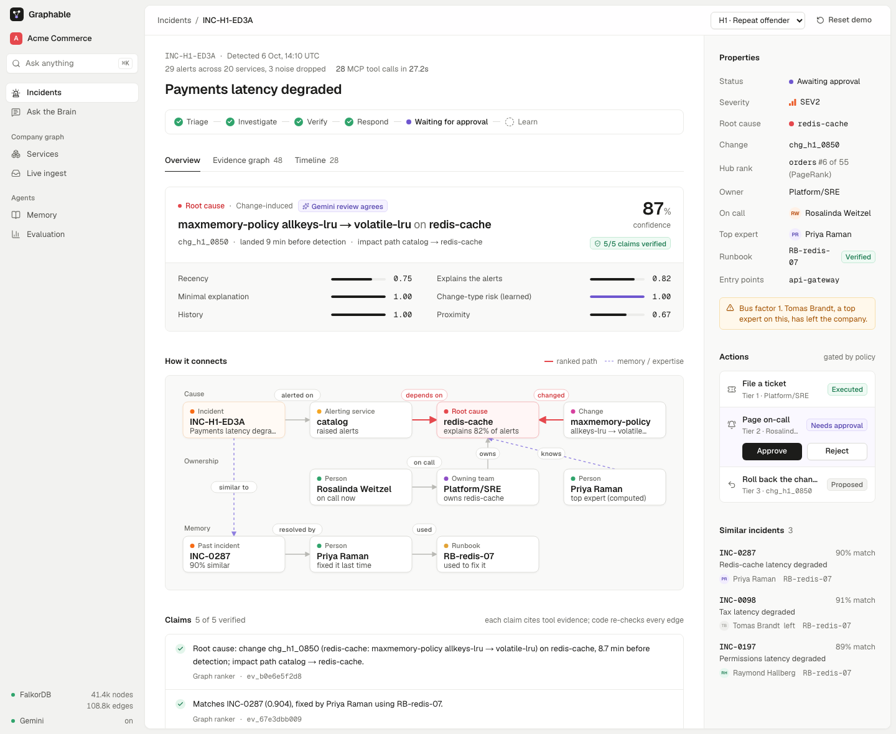
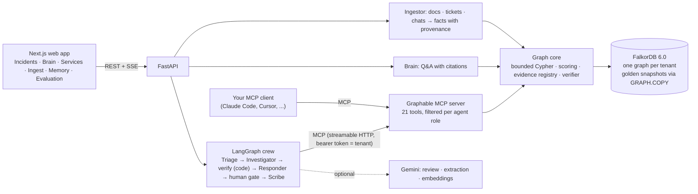
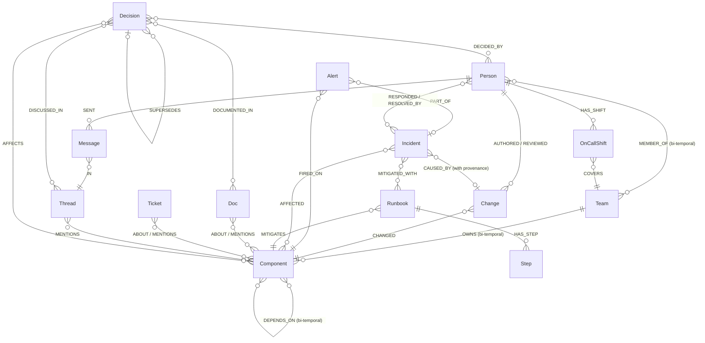
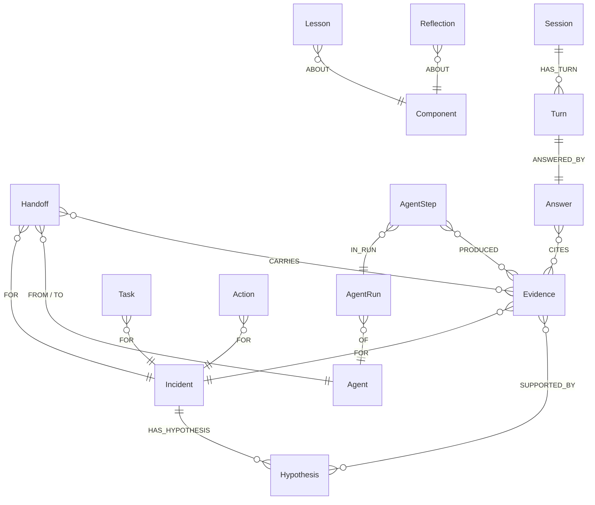

# Graphable: an AI on-call crew whose brain is a FalkorDB graph

**When production breaks, Graphable's agents walk a FalkorDB graph of the company (services, changes, people, docs, chats and past incidents) to find the root cause, the owner, the person who actually knows the system, and how it was fixed last time. Every claim cites a graph path that code re-checks, and a human approves anything risky.**

[Demo video](#demo-video) · [Run it locally](#quickstart) · [Graph data model](#graph-data-model) · [Cypher queries](docs/QUERIES.md) · [Results](#results)

**Tracks entered:** (1) Agents That Act on Connected Data · (2) Agent Memory & Coordination · (3) Company Brain

- **Finds the cause, not the latest deploy.** The agents walk service dependencies and score each recent change by how much of the alerting it explains. On 32 held-out change-caused incidents with planted traps, the right change is ranked first **75% of the time** (picking a random recent change: 18%; blaming the newest change: 0%).
- **Agents remember and coordinate through the graph.** Handoff notes, task claims (compare-and-set), idempotent actions, lessons and conversation history are graph nodes. **20 agents racing for one task produce 1 claim; 20 simultaneous pages produce 1 page.**
- **A company brain that cites its sources.** Ownership, expertise and decisions are extracted from docs, tickets and chats with provenance and kept bi-temporal, so "who owned it in June?" has a correct answer. **29/30** Brain questions correct, **100%** cited, **0** stale answers after a reorg.



> All data is synthetic: a fictional company ("Acme Commerce") with generated names on `*-fake.dev` domains. Built with an AI coding assistant; see the [disclosure](#ai-assistance-disclosure).

---

## Demo video

[Watch the 3-minute demo](DEMO_VIDEO_LINK)

## How each track is covered

| Track | What the track asks for | What Graphable does | Where to see it |
|---|---|---|---|
| (1) Act on connected data | Multi-hop reasoning, graph queries and algorithms as agent tools, tool selection through MCP, explainable actions | 21 domain tools on a real MCP server (each agent sees only its role's tools). Root-cause ranking walks `DEPENDS_ON` up to 5 hops; Triage ranks alerting services with FalkorDB's `algo.pageRank`. Every claim cites an `evidence_id`; a code verifier re-checks the cited edges; pages wait for a human unless the incident is SEV1 with a verified path and high confidence. | Incidents screen · `graphable/mcpserver/server.py` · `graphable/core/tools.py` |
| (2) Memory & coordination | Episodic, semantic and procedural memory, persistent history, shared state and handoffs, concurrency, per-tenant memory | Triage and the Investigator leave a handoff for the next agent in the graph; the Investigator and the Responder read theirs from the graph (`memory_inbox`) before they start. Tasks are claimed with an atomic compare-and-set; actions are `MERGE`d on an idempotency key. Lessons are voted up or down by human feedback. Brain conversations persist as `(:Session)-[:HAS_TURN]->(:Turn)`. One graph per tenant. | Agent memory screen · `graphable/agents/crew.py` · `graphable/agents/scribe.py` |
| (3) Company brain | Docs, tickets and chats in one graph; who owns and who knows what; tracing decisions to their source; keeping knowledge current; answers with sources | Facts extracted from prose carry `source_id` and `span`. Ownership is bi-temporal (`valid_from`/`valid_to`), so a chat message closes the old owner and opens the new one. Expertise is computed from fixes, postmortems, tickets and changes, with bus factor and departed experts. Answers cite evidence. | Ask the Brain, Services and Live ingest screens · `graphable/ingest/` · `graphable/agents/brain.py` |

## Why a graph

Remove FalkorDB and nothing works: there are no root-cause candidates, no "who owned it then", no memory, no shared state between agents and no evidence to cite.

| Question | How the graph answers it |
|---|---|
| What breaks if `redis-cache` fails? | Walk *against* `DEPENDS_ON` (bounded, as of a point in time) |
| Which change caused this? | Walk *along* `DEPENDS_ON` from the alerting services; score each change by how many symptoms it explains, whether a deeper component explains as much, change-type risk learned from history, and recency |
| Has this happened before, and who fixed it? | `(Incident)-[:AFFECTED]->(service)<-[:AFFECTED]-(past)-[:RESOLVED_BY]->(person)`, `(past)-[:MITIGATED_WITH]->(runbook)`, plus vector similarity of incident descriptions |
| Who owned checkout *during* INC-0287? | Bi-temporal `OWNS {valid_from, valid_to, source_id}`; nothing is ever deleted |
| Who actually knows vault? | Expertise computed from fixes, postmortems, runbooks, tickets, changes and help answers, with time decay, bus factor and departed experts |
| Why did we decide ADR-007? | `(Decision)-[:DOCUMENTED_IN]->(Doc)`, `-[:DISCUSSED_IN]->(Thread)`, `-[:DECIDED_BY]->(Person)`, `-[:SUPERSEDES]->(Decision)` |

## Architecture



**Design rules**
- Code does traversal, scoring, verification and gating. The LLM reviews, explains and drafts.
- Agents may only cite `evidence_id`s that tools returned. A code verifier re-checks that every cited relationship existed at incident time.
- Facts are never deleted, only closed (`valid_to`), so history stays queryable.
- The tenant comes from the auth token, never from the LLM. The MCP server enforces each agent role's tool list; external clients get the read-only tools.
- A ticket is filed automatically only with a verified path and enough confidence. A page needs human approval, except for SEV1 incidents with a verified path and very high confidence (on the shared demo every page waits, so visitors can try the approval step). A rollback is only ever proposed.

**Agents**
- **Triage:** ranks the alerting services with FalkorDB PageRank and starts from the most central ones: blast radius, severity, likely team, similar incidents → handoff.
- **Investigator:** reads the handoff, ranks root causes, recalls similar incidents and runbooks → hypothesis and handoff. With a Gemini key, Gemini reviews the ranking with the same tools; if it disagrees, the incident is marked *contested* for a human instead of overriding the graph.
- **Responder:** reads the handoff, finds owner, on-call and real experts, takes gated actions, drafts the status update.
- **Brain:** company Q&A with citations and conversation memory. Common questions (ownership as of a date, experts, blast radius, decisions, staleness, past fixes) go to the matching graph tools; for other questions, with a Gemini key, Gemini chooses the graph tools itself over MCP and every sentence must cite an `evidence_id` those tools returned.
- **Scribe:** consolidates memory, turns feedback into lessons and reflections.
- **Ingestor:** docs, tickets and chats → facts with provenance.

## Graph data model

Ids carry a type prefix (`svc_`, `ds_`, `chg_`, `inc_`, ...). `Service` and `Datastore` nodes also carry the `:Component` label so one traversal covers both. Times are epoch milliseconds. Mutable relationships (`OWNS`, `MEMBER_OF`, `DEPENDS_ON`) are bi-temporal: valid time (`valid_from`, `valid_to`) plus `source_id`/`span` provenance.

### Company world



### Agent memory and coordination



| Nodes (count in the demo graph) | Key properties | Memory type |
|---|---|---|
| Component = Service 40 + Datastore 15 | `id, name, kind, tier, engine, customer_facing, aliases` | semantic |
| Team 11 · Person 131 · OnCallShift 1,078 | `handle, role, left_at` · `start, end, level` | semantic |
| Change 9,697 · Alert 7,143 · Incident 397 | `kind, ts, summary, rolled_back` · `name, ts` · `key, sev, started_at, detected_at` | episodic |
| Thread 1,905 · Message 15,484 · Ticket 2,854 · Doc 439 | `channel` · `text, ts` · `key, title, text` · `kind, title, text` | episodic / semantic |
| Runbook 170 · Step 722 · Decision 120 | `key, status, last_verified_at` · `key, status, decided_at` | procedural / semantic |
| Evidence · Hypothesis · Handoff · Task · Action · AgentRun · AgentStep · Answer · Session · Turn | `tool, node_ids, edge_keys` · `claim, status, confidence` · `summary, open_questions, verification_status` · `status, version, lease_until` · `idem_key, tier, status` | episodic (created at run time) |
| Lesson · Reflection | `text, votes, status` | procedural |

**Indexes and constraints** (`graphable/core/schema.py`): range indexes on `id` for every label and on the time and key properties the queries filter on (relationship-property indexes on `DEPENDS_ON.valid_to` and `OWNS.valid_to` exist, but in the current plans the time filter is applied after the bounded traversal); full-text indexes on components (name and aliases), people, incidents, runbooks, docs, tickets and messages; unique `id` constraints; 768-dimension cosine vector indexes on Incident, Thread, Doc, Ticket and Runbook when embeddings are enabled.

**Tenancy:** one graph per tenant (`t_acme`, `t_globex`, `t_demo_main`). `golden_*` snapshots are cloned with `GRAPH.COPY` for each demo reset and each evaluation scenario.

## Key Cypher queries

Every query and algorithm the product depends on is in **[docs/QUERIES.md](docs/QUERIES.md)**. These carry the product:

| Purpose | Query (abridged) | Code |
|---|---|---|
| **Blast radius**: who is impacted if X fails, as of time `$at` | `MATCH p=(up:Component)-[:DEPENDS_ON*1..3]->(s:Component {id:$id}) WHERE all(r IN relationships(p) WHERE r.valid_from <= $at AND (r.valid_to IS NULL OR r.valid_to > $at)) ...` | `incident_blast_radius` in `core/tools.py` |
| **Root-cause candidates**: everything downstream of the alerting services, with a path kept as evidence | `MATCH p=(a:Component)-[:DEPENDS_ON*0..5]->(c:Component) WHERE a.id IN $A AND ... WITH c, collect(DISTINCT a.id) AS srcs, collect(p)[0] AS sp ...` | `incident_rank_root_causes` |
| **Hub rank** of the alerting services (FalkorDB algorithm) | `CALL algo.pageRank('Component', 'DEPENDS_ON') YIELD node, score ...` | `graph_hubs` (called by Triage) |
| **Episodic recall**: similar past incidents, who fixed them, which runbook | structural overlap `(i:Incident)-[:AFFECTED]->(e) WHERE e.id IN $S` + `CALL db.idx.vector.queryNodes('Incident', 'embedding', 40, q.embedding)` + `vec.cosineDistance` | `incident_similar` |
| **As-of ownership** (bi-temporal) | `MATCH (t:Team)-[o:OWNS]->(:Component {id:$id}) WHERE o.valid_from <= $at AND (o.valid_to IS NULL OR o.valid_to > $at)` | `org_ownership` |
| **Coordination**: atomic task claim; idempotent page; handoff inbox | `MATCH (t:Task {id:$id}) WHERE t.status='SUBMITTED' OR ... SET t.status='WORKING', t.version = t.version + 1` · `MERGE (a:Action {idem_key:$idem}) ...` · `MATCH (h:Handoff {to_agent:$role})-[:FOR]->(:Incident {id:$inc}) ...` | `sim/player.py claim_task` · `_action` · `memory_inbox` |
| **Keeping knowledge current**: a chat message closes the old `OWNS` edge and opens a new one with provenance | `... SET o.valid_to = $vf, o.invalidated_by = $src ... CREATE (t)-[:OWNS {valid_from:$vf, source_id:$src, span:$span}]->(c)` | `ingest/pipeline.py` |
| **Hybrid search** for the Brain | `CALL db.idx.fulltext.queryNodes(...)` and `CALL db.idx.vector.queryNodes(...)`, fused by reciprocal rank | `knowledge_search` |

**FalkorDB features used:** one graph per tenant · `GRAPH.COPY` snapshots · `GRAPH.RO_QUERY` with per-query timeouts · `GRAPH.EXPLAIN` before running agent-written Cypher · unique constraints · range indexes on node and relationship properties · full-text indexes (including fuzzy matching for typos) · HNSW vector indexes with `vecf32` and `vec.cosineDistance` · `algo.pageRank` and `algo.betweenness` · `allShortestPaths`.

## Quickstart

**Prerequisites:** Docker with Compose v2. For the manual path: Python 3.12 with [uv](https://docs.astral.sh/uv/), and Node.js 20.9 or newer. A Gemini API key is optional.

There is no hosted deployment; the full stack runs locally with one command.

### Option A: Docker (one command)

```bash
git clone https://github.com/devanshucodes/graphable && cd graphable
cp .env.example .env          # optional: add GEMINI_API_KEY
docker compose up --build
```

| What | URL |
|---|---|
| Web app | http://localhost:3001 |
| API docs | http://localhost:8000/docs |
| MCP endpoint | http://localhost:8765/mcp (header `Authorization: Bearer dev-acme`) |
| FalkorDB Browser | http://localhost:3000 |

If a port is already taken, set `WEB_PORT`, `API_PORT`, `MCP_PORT`, `FALKORDB_PORT` or `FALKORDB_BROWSER_PORT` in `.env`. The local setup pins FalkorDB 6.0.2; the queries also run on FalkorDB 4.22, the version on FalkorDB Cloud's free tier.

### Option B: manual (for development and evaluations)

```bash
git clone https://github.com/devanshucodes/graphable && cd graphable
docker run -d --name graphable-db -p 6379:6379 falkordb/falkordb:6.0.2
uv sync --frozen --extra dev                         # Python dependencies from uv.lock, plus pytest
uv run python -m graphable.bootstrap                 # load the committed dataset, extract knowledge, create snapshots
GRAPHABLE_ALLOW_EVAL_TOKENS=1 uv run python -m graphable.mcpserver.server --port 8765 &
uv run uvicorn graphable.api.app:app --port 8000 &
cd apps/web && npm ci && npm run build && npm start   # http://localhost:3001
```

`GRAPHABLE_ALLOW_EVAL_TOKENS=1` is only needed to run the evaluations over MCP; leave it off otherwise.

### Try it in two minutes

1. **Incidents → Run "Repeat offender".** Watch Triage, Investigator and Responder work in the Timeline tab. The Overview names the silent `redis-cache` config change, shows the causal chain, recalls INC-0287 and who fixed it, files a ticket and waits for you to approve the page.
2. **Run "Not a change".** A certificate expired: the crew does not blame any deploy, and it warns that the expert on that system has left.
3. **Live ingest:** send "FYI from today checkout is owned by Orbit". The graph diff shows the old `OWNS` edge closed, not deleted, and the new one with the message as its source.
4. **Ask the Brain:** "Who knows vault best?", then "Are its runbooks stale?" (the follow-up uses the conversation's memory).

### Connect your own MCP client

```bash
claude mcp add --transport http graphable http://localhost:8765/mcp --header "Authorization: Bearer dev-acme"
```

Any MCP client that supports streamable HTTP can connect the same way: URL `http://localhost:8765/mcp`, header `Authorization: Bearer dev-acme`. The token selects the tenant.

### Optional: Gemini

Set `GEMINI_API_KEY` in `.env` before running bootstrap to turn on Gemini review of the Investigator's ranking, Gemini knowledge extraction, embeddings for vector search, and grounded Brain answers for free-form questions. If you add the key later, run bootstrap again and then press Reset demo. Without a key, the deterministic policies run; they are also the evaluation baseline. All variables are listed in [.env.example](.env.example).

## Results

Synthetic data and small samples: read these as a demonstration, not a benchmark. Weights were tuned on 40 *train* scenarios, frozen, then scored on 40 *held-out test* scenarios. Every scenario runs on a fresh `GRAPH.COPY` of the snapshot.

| Capability | Result | Baseline / note | Source |
|---|---|---|---|
| Root cause, change-caused incidents (n=32) | **top-1 75% · top-3 88% · MRR 0.88** | untuned weights 47% · random recent change 18% · fewest hops, then newest 16% · newest change 0%. Wrongly said "not a change": 16% | `rca_test.json` |
| Incidents not caused by a change (n=8) | correctly declined to blame a change 75%, right origin 100% | look-alike traps (n=4): 100% · multi-root (n=4): 50% | `rca_test.json` |
| Claims backed by real graph relationships | 100% (graph-only crew) · 96% with Gemini review | rejected claims are shown as rejected, never acted on | `system_mcp.json`, `crew_gemini_mcp.json` |
| Cited paths that exist at incident time | 100% |  | `system_mcp.json` |
| Paged the correct team | 82% |  | `system_mcp.json` |
| Concurrency | 20 racing claims → 1 · 20 simultaneous pages → 1 action |  | `system_mcp.json` |
| Tenant isolation | 0 leaks | second tenant with identical service names | `system_mcp.json` |
| Brain questions | 29/30 correct, 100% cited | weakest: why decision (5/6) | `system_mcp.json` |
| Answers after a reorg | 6/6 correct, 0 stale |  | `system_mcp.json` |
| Learning a new failure pattern | wrong 3×, then 5/5 | after on-call corrections are written to the graph | `system_mcp.json` |
| Fact extraction from docs, tickets, chats | Gemini precision 0.86 / recall 0.90 | rules 0.86 / 0.86 | `extraction_*.json` |
| Gemini review of the ranking | 4 incidents marked contested for a human (1 of them actually wrong) · 0 overrides | review unavailable on 8 of 40 (API timeout): the graph's answer stands | `crew_gemini_mcp.json` |
| Per incident | 21 MCP calls, 2.3 s (graph only) · 24 calls, 126 s average with Gemini review | review time depends on Gemini API latency; the UI shows the graph's answer within a second and marks it provisional | `system_mcp.json`, `crew_gemini_mcp.json` |

**What the LLM adds, measured:** letting Gemini override the graph's ranking fixed 1 incident and broke 3 look-alike traps. So a disagreement now marks the incident *contested* for a human, and the graph's answer stands.

Reproduce: `uv run python -m graphable.evals.rca --set test --tuned` · `uv run python -m graphable.evals.system --bus mcp` (MCP server started with `GRAPHABLE_ALLOW_EVAL_TOKENS=1`) · `uv run pytest -q`.

## Limitations

- Synthetic data, 40 test incidents. Real-world root-cause analysis is much harder: the OpenRCA and ITBench benchmarks report roughly 11% for LLM agents.
- The tuned weights lean on coverage and change-type risk. Recency gets little weight because the generator's decoy changes are deliberately recent.
- **20% of test incidents (8 of 40) got an automatically filed ticket that pointed at the wrong root cause** (ticket precision 77%). Pages and rollbacks therefore stay human-gated.
- Multi-root incidents are weaker (0.50 top-1), and extraction of `AFFECTS` relationships is the weakest relation (precision 0.60).
- Graph algorithms (`algo.*`) see every `DEPENDS_ON` edge, including closed ones; the bi-temporal filters apply to the Cypher traversals.
- Any chat author can move ownership with a message; there is no authority check yet (the change is recorded with its source, so it is auditable and reversible).
- Two intakes racing on the same alerts could both open an incident; the demo runs one intake at a time.
- Pages, tickets and rollbacks are simulated and recorded in the graph; there are no real integrations.

## Data (100% synthetic)

"Acme Commerce" is a fictional marketplace with generated names on a fictional domain:
- 40 services, 15 datastores, 131 people and 11 teams;
- 12 months of history: 9.7k changes, 397 incidents, 7.1k alerts, 15k chat messages, 2.9k tickets, 440 docs, 170 runbooks, 120 decisions;
- about 41k nodes and 108k relationships once loaded and extracted (the sidebar shows the live counts).

The history includes a reorg, a new team, departures, a sale-week capacity spike and a year-end freeze. It also includes deliberate traps: decoy deploys, silent root causes, look-alike incidents, service aliases and typos, two people with the same first name, stale runbooks, superseded decisions, prompt-injection strings in tickets, and a second tenant (`globex`) with identical service names.

The generator is deterministic. It writes the ground truth used for scoring to `truth/`, which is never loaded into the graph.

## Repository layout

```
datagen/             synthetic world generator and the committed dataset (datagen/out)
graphable/core       tenancy, schema, domain tools, evidence registry, verifier, embeddings
graphable/ingest     loader for systems of record; extractor and pipeline (prose → facts with provenance)
graphable/mcpserver  FastMCP server: 21 tools, bearer-token tenancy
graphable/agents     LangGraph crew, policies (deterministic and Gemini), Brain, Scribe, tool buses (MCP or direct)
graphable/api        FastAPI + server-sent events
graphable/sim        scenario player and graph-based alert intake
graphable/evals      root-cause and system evaluations
apps/web             Next.js app (custom SVG graph views)
docs/                QUERIES.md (every Cypher query), ARCHITECTURE.md, DATA_SPEC.md, RESEARCH.md
tests/               integration tests
```

## AI assistance disclosure

Graphable was built by Devanshu Saxena (team "Graphable") with **Claude (Anthropic), used as an AI coding assistant through Claude Code**. Claude did the literature review, proposed designs, and wrote most of the code, tests and documentation. Devanshu chose the problem and the tracks; made the stack and architecture decisions (FalkorDB as the system of record, Gemini as the LLM, LangGraph for the crew, a real MCP server rather than direct calls, a custom web UI, a 30–50k-node dataset with full docs/tickets/chats extraction); directed the product and UI, including rejecting two UI designs; and asked for independent multi-agent reviews of the finished project, whose findings were then fixed. Gemini (Google) is an optional runtime dependency, not a coding assistant.

Problems the evaluations caught and how they were fixed: hub services gluing unrelated alerts into one incident (no correlation through hubs) · changes after detection being rewarded (causes must come before symptoms) · a bias toward silent roots (coverage-based scoring) · an over-confident prior for unseen change types (empirical-Bayes smoothing) · FalkorDB's 10k result limit truncating reads (paging) · a prompt-only tool budget that let some runs loop (budget enforced in code) · an LLM override policy that hurt accuracy (contested instead of override).
