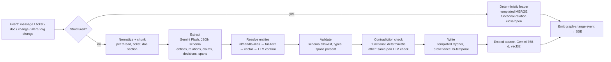
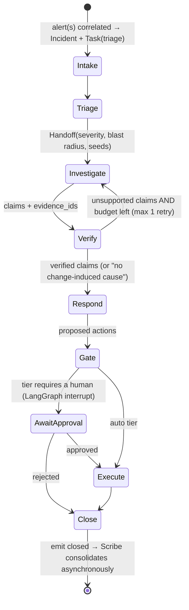
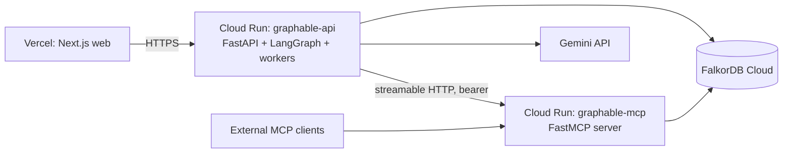

# Graphable: System Architecture

**What it is:** a graph-native, multi-agent incident response system with a company brain. **FalkorDB is the system of record** for the company's knowledge, the agents' memory and the agents' coordination.
**Status:** design document. The implementation is in this repo; README.md has setup and current results.
**Grounding:** every major decision cites RESEARCH.md (`R§n` = RESEARCH.md section n).

---

## 1. Engineering principles

| # | Principle | What it means in practice |
|---|---|---|
| P1 | **The graph is the source of truth** | Topology, knowledge, memory, coordination, evidence and audit all live in FalkorDB. Agent runtime state only holds IDs and cursors. Remove FalkorDB and nothing works (rule 3). |
| P2 | **Deterministic core, probabilistic edge** | Code does traversal, scoring, verification, gating and writes. The LLM selects, interprets, explains and drafts (R§0 decisions 1, 3, 11). |
| P3 | **Provable by construction** | Every claim carries `evidence_id`s from executed tool calls, and a code verifier rejects anything else (R§2.4). |
| P4 | **Never delete; invalidate** | Mutable facts are bi-temporal and episodic memory is append-only, so history is always queryable (R§3.4). |
| P5 | **Templated writes only** | The LLM emits typed JSON (Pydantic); only reviewed Cypher templates touch the graph (Zep pattern). |
| P6 | **One atomic statement per logical write** | FalkorDB has one writer per graph and no multi-statement transactions, so writes are idempotent `MERGE`/CAS statements (R§1.2). |
| P7 | **Tenant scope comes from authentication, never from the LLM** | The graph is chosen per tenant at the connection layer. Every template is scoped, including get-by-id (R§3.6). |
| P8 | **Bounded everything** | Hop caps ≤ 4–5, allowlisted relationship types, row limits, query timeouts, tool-call budgets per agent, LLM retries with backoff. |
| P9 | **Observable by design** | Every agent step, tool call, evidence item and action is a graph node, so the audit trail *is* the data model. |
| P10 | **Measured, not claimed** | An eval harness with ground truth and traps runs on every change to scoring (R§9). |

---

## 2. System context


---

## 3. Tech stack

| Layer | Choice | Why |
|---|---|---|
| Graph DB | **FalkorDB**: Cloud in production, Docker locally (pinned tag) | Required; per-tenant graphs; vector and full-text indexes; algorithms (R§1) |
| Language | **Python 3.12**, `uv` for environments and locking | `falkordb` client 1.7.x needs ≥ 3.10 |
| Graph client | `falkordb` (async), one connection pool per process | Async to suit FastAPI and LangGraph |
| Contracts | **Pydantic v2** models for every tool input/output, extraction schema and event | Typed boundaries between LLM output and the graph |
| MCP server | Official `mcp` Python SDK (**FastMCP**), **streamable HTTP** transport, bearer auth | Real MCP that judges can plug into their own clients (Track 1) |
| Agents | **LangGraph** (StateGraph, interrupts, checkpointer) + `langchain-google-genai` + `langchain-mcp-adapters` | Explicit state machine, human-approval gate, MCP tool loading (R§3.5) |
| LLM | **Gemini**: Pro-class for Investigator and Brain; Flash-class for Triage, Responder, Ingestor, Scribe | Reasoning where it matters, speed and cost everywhere else |
| Embeddings | Gemini embeddings, **768-dim** (output dimensionality reduced) | Keeps vector memory small enough for the Cloud tier |
| Analytics | `networkx` for personalized PageRank on incident subgraphs; FalkorDB `algo.*` for global metrics | FalkorDB PageRank isn't personalized (R§1.2) |
| API | **FastAPI** + Uvicorn, **SSE** for live agent events | Simple streaming; works through Cloud Run |
| Web | **Next.js (App Router) + TypeScript + Tailwind + shadcn/ui + TanStack Query + `@falkordb/canvas`** | Polished UI with FalkorDB's own graph rendering |
| Deploy | DB on FalkorDB Cloud · API + MCP on **Google Cloud Run** (2 services, 1 image) · Web on **Vercel** | Locked decision 6 |
| Secrets | Cloud Run Secret Manager / Vercel env | No keys in the repo |
| Quality | `pytest` + a fixture graph, `ruff`, `mypy` on core; Playwright smoke test of the web app (optional) | — |

---

## 4. Logical architecture: components

### 4.1 Graph Core (`graphable.core`), the heart of the system
- **Connection and tenancy:** `TenantGraph(tenant_id)` maps to graph `t_<tenant>`. Every query goes through it. The read path uses `ro_query` with timeouts.
- **Query templates:** a registry of named, parameterized Cypher templates. Hop bounds and relationship types come from allowlists and are inlined after validation (FalkorDB can't parameterize them). The `coalesce()` rule is applied to every grouping key.
- **Evidence registry:** every read tool registers what it returned as an `Evidence` node:
  - `{id, tool, params_hash, node_ids, edge_keys, ts}`, linked to the `AgentStep` that made the call.
  - Edges are identified by a stable key `(src_id, TYPE, dst_id, valid_from)`, never by internal IDs.
- **Scoring:** root cause (§9.1), similarity (§9.2), expertise (§9.3), action-gate score (§9.4). These are pure functions over tool results, so they can be unit-tested.
- **Verifier:** checks claims against the evidence registry (§8.4).
- **Analytics jobs:** after load and nightly, compute PageRank, seeded betweenness, transitive-dependent counts and change-failure-rate priors, stored as properties with `computed_at`.

### 4.2 Graphable MCP Server (`graphable.mcp`)
- FastMCP over streamable HTTP. One bearer token per tenant **resolves the tenant**; the LLM never passes it.
- Tools are thin wrappers over Graph Core and return `structuredContent` with Pydantic output schemas. Errors come back as `isError` with an actionable message.
- Annotations: `readOnlyHint` on reads; `destructiveHint=false, idempotentHint=true` on memory writes; actions marked `destructiveHint=true`.
- Tool catalogue: §7.

### 4.3 Agent Runtime (`graphable.agents`)
- **Incident Crew** (a LangGraph StateGraph): Triage → Investigator → Verifier → Responder → Action Gate → Close (§8).
- **Brain:** a ReAct agent for company-brain Q&A with citations (Track 3).
- **Scribe:** a background consolidation and learning worker (Track 2).
- Agents load MCP tools through `MultiServerMCPClient` and are **filtered to role-specific subsets** of ≤ 9 tools.

### 4.4 Ingestion Pipeline (`graphable.ingest`)
- **Structured records** (changes, alerts, on-call, org changes, ticket metadata) go to deterministic loaders with templated `MERGE`.
- **Prose** (threads, tickets, docs) goes to the **Ingestor** (LLM extraction): normalize → extract → resolve → validate → contradiction check → write with provenance → embed (§6).

### 4.5 API Gateway (`graphable.api`)
REST endpoints for ingestion, incidents, approvals, Brain Q&A, entity pages and eval results, plus SSE streams of agent events (§11).

### 4.6 Web App (`apps/web`)
Six screens (§12).

### 4.7 Scenario Player and Eval Harness (`graphable.sim`, `eval/`)
- Replays a scenario's event stream into the API in accelerated time; this drives the live demo.
- Runs test scenarios headless and computes the scoreboard (§14).

---

## 5. Data model (FalkorDB)

Full field lists for the generator are in DATA_SPEC.md. This section is the architectural contract.

### 5.1 Conventions
- **IDs:** string, with a type prefix: `svc_checkout`, `per_0042`, `team_payments`, `chg_008812`, `inc_0311`, `msg_…`, `doc_…`, `tkt_…`, `ev_…`, `step_…`.
- **Time:** epoch-ms integers (`*_at`, `ts`). FalkorDB has no timezone types (R§1.2).
- **Bi-temporal properties on mutable edges** (†): `valid_from`, `valid_to` (null means current), `recorded_at`, `expired_at` (null means current belief), `source_id`, `confidence`.
- **Provenance on extracted facts:** `source_id`, `span` (a quoted excerpt), `extracted_by` (ExtractionRun id), `confidence`.
- **Memory-type tag** on nodes where useful: `mem: 'semantic'|'episodic'|'procedural'|'working'` (CoALA, R§3.1). This makes the memory layers visible in the browser.

### 5.2 Node labels

| Group | Labels |
|---|---|
| Org (semantic) | `Person`, `Team`, `OnCallShift` |
| Systems (semantic) | `Service`, `Endpoint`, `Datastore`, `FeatureFlag`, `Region` |
| Change and ops (episodic sources) | `Change`, `Alert` |
| Knowledge sources (PROV Entities) | `Thread`, `Message`, `Ticket`, `Doc` (kind: postmortem, design, wiki), `Runbook`, `Step` |
| Knowledge (semantic) | `Decision`, `Claim`, `Topic` (optional) |
| Incident memory (episodic) | `Incident`, `Hypothesis`, `Action` |
| Agent memory and coordination | `Agent`, `AgentRun`, `AgentStep`, `Task`, `Handoff`, `IncidentBrief`, `Evidence`, `Answer`, `Session`, `Turn` |
| Procedural learning | `Lesson`, `Reflection` (Runbook and Step are shared with knowledge) |
| Pipeline | `ExtractionRun`, `Unresolved` |

### 5.3 Relationship types (direction is semantic)

| Domain | Relationships |
|---|---|
| Org | `(Person)-[:MEMBER_OF†]->(Team)`, `(Team)-[:OWNS†]->(Service)` (exactly one active), `(Person)-[:HAS_SHIFT]->(OnCallShift)-[:COVERS]->(Team)`, `(Person)-[:REPORTS_TO†]->(Person)` |
| Topology | `(Service)-[:DEPENDS_ON† {kind: sync\|async\|db\|cache\|queue, critical}]->(Service\|Datastore)`, `(Service)-[:EXPOSES]->(Endpoint)`, `(Service)-[:DEPLOYED_IN]->(Region)`, `(FeatureFlag)-[:GATES]->(Service)` |
| Change | `(Change)-[:CHANGED]->(Service\|Datastore\|FeatureFlag)`, `(Person)-[:AUTHORED]->(Change)`, `(Person)-[:REVIEWED]->(Change)`, `(Change)-[:IMPLEMENTS]->(Decision)` |
| Signals | `(Alert)-[:FIRED_ON]->(Service)`, `(Alert)-[:PART_OF]->(Incident)` |
| Incident memory | `(Incident)-[:AFFECTED]->(Service)`, `(Incident)-[:CAUSED_BY {source_id,confidence}]->(Change\|Service)`, `(Incident)-[:SIMILAR_TO {score, basis, computed_at}]->(Incident)`, `(Person)-[:RESPONDED {role: commander\|fixer\|helper}]->(Incident)`, `(Incident)-[:RESOLVED_BY]->(Person)`, `(Incident)-[:MITIGATED_WITH {outcome, verified}]->(Runbook)`, `(Incident)-[:HAS_HYPOTHESIS]->(Hypothesis)-[:SUPPORTED_BY\|REFUTED_BY]->(Evidence)` |
| Knowledge and provenance | `(Message)-[:IN]->(Thread)`, `(Message)-[:REPLY_TO]->(Message)`, `(Person)-[:SENT]->(Message)`, `(Person)-[:WROTE]->(Doc\|Runbook)`, `(Thread\|Ticket\|Doc)-[:MENTIONS]->(*)`, `(Decision)-[:DOCUMENTED_IN]->(Doc)`, `(Decision)-[:DISCUSSED_IN]->(Thread\|Ticket)`, `(Decision)-[:DECIDED_BY]->(Person)`, `(Decision)-[:AFFECTS]->(Service)`, `(Decision)-[:SUPERSEDES]->(Decision)`, `(Ticket)-[:ASSIGNED_TO]->(Person)`, `(Ticket)-[:RESOLVED_BY]->(Person)`, `(Ticket)-[:FOLLOW_UP_OF]->(Incident)`, `(Claim)-[:SUPPORTED_BY {span}]->(Message\|Doc\|Ticket)`, `(*)-[:ASSERTED_BY]->(ExtractionRun)` (AriGraph/PROV) |
| Procedural | `(Runbook)-[:HAS_STEP]->(Step)-[:NEXT]->(Step)`, `(Runbook)-[:MITIGATES]->(Service)`, `(Runbook)-[:SUPERSEDES]->(Runbook)`, `(Lesson)-[:DERIVED_FROM]->(Incident)`, `(Lesson)-[:ABOUT]->(Service\|Runbook)` |
| Agent coordination | `(Task)-[:FOR]->(Incident)`, `(Handoff)-[:FOR]->(Incident)`, `(Handoff)-[:FROM]->(Agent)`, `(Handoff)-[:TO]->(Agent)`, `(Handoff)-[:CARRIES]->(Hypothesis\|Evidence)`, `(AgentRun)-[:OF]->(Agent)`, `(AgentRun)-[:WORKED_ON]->(Incident)`, `(AgentRun)-[:INFORMED_BY]->(AgentRun)` (PROV wasInformedBy), `(AgentStep)-[:IN_RUN]->(AgentRun)`, `(AgentStep)-[:NEXT]->(AgentStep)`, `(AgentStep)-[:PRODUCED]->(Evidence)`, `(Action)-[:FOR]->(Incident)`, `(Action)-[:JUSTIFIED_BY]->(Evidence)`, `(Action)-[:APPROVED_BY]->(Person)` |
| Q&A memory | `(Person)-[:HAS_SESSION]->(Session)-[:HAS_TURN]->(Turn)-[:NEXT]->(Turn)`, `(Answer)-[:CITES {verdict}]->(*)`, `(Answer)-[:GENERATED_BY]->(AgentRun)` |
| Derived (computed, never ground truth) | `(Person)-[:KNOWS {score, evidence_count, last_evidence_at, computed_at}]->(Service)` (materialized by the Scribe; can also be computed on demand) |

### 5.4 Indexes and constraints (created by the migration step)
- **Range indexes:** `id` on every label; `Service.name`; `Change.ts`; `Alert.ts`; `Incident.started_at`; `Message.ts`; `Person.handle`; `Task.status`.
- **Unique constraints** (`GRAPH.CONSTRAINT`, after the range index): `id` on core labels; `Action.idem_key`.
- **Full-text indexes** (DDL form only; the procedure form is broken on 6.x): `Runbook(title, body)`, `Doc(title, text)`, `Ticket(title, text)`, `Thread(summary)`, `Service(name, aliases_text)`, `Person(name, handle)`.
- **Vector indexes** (768-dim, cosine; always write with `vecf32()`): `Incident.embedding`, `Thread.embedding`, `Doc.embedding` (per section), `Ticket.embedding`, `Runbook.embedding`. Messages are **not** embedded individually, to save memory.

### 5.5 Tenancy
- **One graph per tenant:** `t_acme` (main demo company) and `t_globex` (a small second company with **identical service names**, for the isolation demo).
- **Golden snapshots:** `golden_acme` gets copied to `t_acme` (`GRAPH.COPY`) for a one-click demo reset.
- **Shared nothing:** no cross-graph queries, so tenant isolation is structural.

---

## 6. Ingestion pipeline: how the company brain stays current (Track 3)



**Rules:**
- Extract **one thread, ticket or doc section per call** (small chunks, R§4.4).
- The extraction schema enumerates the allowed labels and relationship types, with a `RELATED_TO {label}` escape hatch that is canonicalized later or dropped (EDC).
- **Never create a Service or Person from prose.** Unknown mentions become `Unresolved` nodes for review (no over-merging, R§4.4).
- **Functional relations** (`OWNS`, `MEMBER_OF`, active on-call) are closed and opened in one statement. Example: "checkout moved to Team Orbit" sets `valid_to` on the old `OWNS` and creates the new one with `source_id = msg_…`.
- **Contradiction check before deduplication** (MemClaw ordering, R§3.4).
- **Idempotency key** = `source_id + extractor_version`, so re-ingesting is a no-op.
- Each run creates an `ExtractionRun{model, prompt_version, at}` node, and every extracted edge points to it.
- **Prompt-injection hygiene:** source text goes inside a delimited "DATA" block, the model is told to treat it as data, and extraction output has no tool-calling ability.

**Staleness detector** (Scribe job; DOCER rules, R§4.6): flag a `Runbook` or `Doc` when
- it mentions a missing entity,
- `last_verified_at` is earlier than the latest `Change` to its service,
- its author has `left_at` set, or
- it cites a superseded `Decision`.

---

## 7. MCP tool catalogue (Graphable MCP Server)

Names are namespaced with underscores. Every read returns `evidence_ids` and a compact, ranked payload (most important first).

| # | Tool | Purpose | Notes |
|---|---|---|---|
| 1 | `graph_resolve(text, kinds?, k=5)` | Entity linking | exact/alias → full-text → vector |
| 2 | `graph_schema()` | Labels and relationships, **with direction in English** | "A DEPENDS_ON B: A calls B; if B fails, A is impacted" |
| 3 | `graph_neighbors(node_id, rel_types?, direction, limit=25)` | Local exploration | **Hub rule:** degree > 40 with no filter → counts by relationship type only |
| 4 | `incident_blast_radius(service_id, max_hops≤4, at?)` | Upstream impact | hops, entry points, owners, tiers |
| 5 | `incident_rank_root_causes(incident_id, window_min=120, max_hops≤5)` | Root-cause candidates with a **score breakdown** | §9.1 |
| 6 | `graph_explain_connection(from_id, to_id, max_len≤4, k=3)` | Paths between two entities | `algo.SPpaths` / `allShortestPaths` |
| 7 | `incident_similar(incident_id, phase: triage\|post, k=5)` | Hybrid similarity | fixer, runbook, linking paths |
| 8 | `org_ownership(service_id, at?)` | Owner team, on-call, escalation, **as of a time** | bi-temporal |
| 9 | `org_experts(service_id? \| query?, k=5)` | KNOWS ranking, top-3 evidence each, **bus factor** | §9.3 |
| 10 | `knowledge_for_entity(node_id, kinds, k=3)` | Runbooks, decisions, postmortems, with staleness flags | "graph to find, text to explain" |
| 11 | `knowledge_search(query, kinds?, k=8)` | Hybrid vector + full-text + graph search over sources | Brain |
| 12 | `decision_trace(decision_id \| query)` | Decision → discussions → people → superseded-by chain | Track 3 |
| 13 | `graph_hubs(metric, k=10)` | Precomputed PageRank / betweenness (fixed seed) | importance, **not** cause |
| 14 | `graph_cypher_readonly(cypher, params, purpose)` | Guarded escape hatch | ro_query, EXPLAIN pre-check, bounded `*`, ≤ 50 rows, shown in the UI |
| 15 | `memory_note(incident_id, kind: hypothesis\|finding\|ruled_out, claim, evidence_ids, confidence)` | Write to the blackboard | rejects unknown evidence |
| 16 | `memory_handoff(incident_id, to_role, summary, open_questions, evidence_ids)` | Structured handoff | MAST fields |
| 17 | `memory_recall(scope, query, k)` | Retrieve lessons, reflections, past sessions | role-filtered (LEGOMem) |
| 18 | `action_create_ticket(...)` | Gated T1 | idempotency key |
| 19 | `action_page_oncall(...)` | Gated T2 | idempotency key |
| 20 | `action_propose_remediation(...)` | T3, always pending | — |

**Role subsets (≤ 9 each):**

| Agent | Tools |
|---|---|
| Triage | 1, 4, 7, 8, 13, 15, 16 |
| Investigator | 1, 3, 5, 6, 7, 10, 14, 15, 16 |
| Responder | 8, 9, 10, 17, 15, 18, 19, 20 |
| Brain | 1, 2, 3, 6, 8, 9, 11, 12, 14 |

Scribe and Ingestor call Graph Core directly; they are workers, not tool-selecting agents.

---

## 8. Agent architecture (LangGraph)

### 8.1 Agent roster

| Agent | Type | Model | Memory it reads | Memory it writes |
|---|---|---|---|---|
| **Triage** | ReAct inside a fixed procedure | Flash | semantic (topology, ownership), episodic (similar incidents) | Hypothesis seeds, severity, Handoff |
| **Investigator** | Procedure, then bounded ReAct (≤ 10 tool calls) | Pro | all three | Hypotheses (proposed/ruled_out), notes, Handoff |
| **Responder** | Procedure + drafting | Flash | procedural (runbooks, lessons), org | Actions (gated), drafts, Handoff |
| **Brain** | ReAct Q&A with citations | Pro | everything, read-only | Session, Turn, Answer + CITES |
| **Scribe** | Background worker | Flash | the closed incident's subgraph | Summary, embedding, SIMILAR_TO, Lessons (votes), KNOWS, proposed Runbook, staleness flags |
| **Ingestor** | Pipeline worker | Flash | resolution indexes | Knowledge facts with provenance |

### 8.2 Incident Crew state machine



**LangGraph state (thin):** `{tenant, incident_id, run_ids, brief_id, phase, budget_left, hypothesis_ids, verified_claim_ids, pending_action_ids}`. Everything substantive is read from and written to FalkorDB (P1).

**Checkpointer:** the LangGraph checkpointer (the FalkorDB checkpointer if it works on our version, otherwise Redis/SQLite) is used only to **resume runs and interrupts**. Durable memory is our graph.

### 8.3 Intake: graph-based alert correlation
Alerts within 5 minutes of each other whose services are connected within 2 `DEPENDS_ON` hops (in either direction) are grouped into one `Incident`. This is a small graph query and avoids opening one incident per alert. The Task claim is a single-statement CAS (R§3.6), so concurrent intakes never double-open an incident.

### 8.4 Verifier (pure code)
For each claim:
1. Every `evidence_id` exists **and** belongs to this incident's runs.
2. Every edge key in that evidence still exists (re-matched by `(src, TYPE, dst, valid_from)`).
3. Every entity the claim names (resolved IDs) appears in the cited evidence's node set.
4. Root-cause claims must cite a `rank_root_causes` evidence that includes the candidate.

Failing claims are dropped and logged as `Reflection{reason}`. The output records `path_validity_rate` for the scoreboard.

### 8.5 Prompts and contracts
- System prompts include: role, procedure, the **direction-annotated schema**, 2–3 worked trajectories (Graph-CoT), "cite evidence_ids or say 'insufficient evidence'", the tool budget, and the **IncidentBrief**, which is the working memory (capped at ~1.5k tokens).
- Outputs are Pydantic models (Gemini structured output). Any invalid output gets one repair retry, then fails.

### 8.6 Concurrency
- Several incidents can run at once; each crew is its own LangGraph thread.
- Graph writes are single-statement and idempotent, and task claims use CAS with leases.
- `Action.idem_key` is unique, so the same page is never sent twice.
- A test runs N crews × M incidents and asserts zero duplicate claims and zero duplicate pages.

---

## 9. Algorithms (full rationale in R§7)

### 9.1 Root-cause ranking (`incident_rank_root_causes`)
1. **Candidates:** services `c` reachable along `DEPENDS_ON*0..5` from the alerting set A (as of the incident time). Changes `x` on `c` with `t0−2h ≤ ts ≤ t0+5min`.
2. **Score:** `S = 0.30·P + 0.25·R + 0.15·Cov + 0.15·F + 0.10·K + 0.05·H`

   | Term | Meaning |
   |---|---|
   | P | Proximity, `2/(2+h)` |
   | R | Recency decay |
   | Cov | Ochiai coverage across symptom chains |
   | F | Frontier: alerting with healthy dependencies, or a silent convergence point |
   | K | Smoothed change-failure prior for (kind, service), plus a canary bonus |
   | H | Similarity to past incidents with the same (service, kind) |

3. **Tie-break:** personalized PageRank on the incident subgraph, with alert severity as the seed (networkx).
4. **Abstain:** if `max S < θ`, return non-change hypotheses (frontier or coverage service with a fault-type guess).
5. **Output:** ranked candidates with a per-term breakdown and evidence IDs. The UI shows the breakdown as a bar.

Weights and θ are tuned on training seeds only and frozen before the test run.

### 9.2 Similarity (`incident_similar`)
`sim = 0.35·s_root + 0.20·s_kind + 0.15·J(symptoms) + 0.15·J(blast) + 0.15·cos(text)`
- **Triage phase:** no root yet, so only the J, J and cos terms, renormalized.
- **Post-investigation:** an expectation over the top-3 hypotheses.
- **Retrieval:** vector top-20, then graph rerank, plus recency `0.99^days`, plus a verified-outcome bonus.
- The query incident and anything after `t0` are excluded (no leakage).

### 9.3 Expertise (`org_experts`)
`KNOWS(p,s) = active(p)·Σ w(type)·2^(−Δt/H) + 0.3·Σ_{neighbors} KNOWS₀`
- **Weights:** fixer 5, postmortem/ADR author 4, runbook author 3, ticket resolver 3, change author 2, reviewer 1.5, helper 1.5, chat answer 1 (max 1 per thread).
- **Half-life H:** 180 days, or 365 for designs.
- **Bus factor:** the number of active people with normalized score ≥ 0.75. Departed experts are listed with ranked successors.

### 9.4 Action gate score
`G = S_top × verified_path(0/1) × agreement` (agreement across 3 Investigator samples, if enabled). Tiers: T0 automatic; T1 automatic if `G ≥ 0.6`; T2 needs approval unless SEV-1 and `G ≥ 0.8`; T3 always proposal only. Thresholds are calibrated on training scenarios.

### 9.5 Memory retrieval (`memory_recall`)
Score = min-max normalized `relevance + recency + importance`, where importance comes from severity or vote count (Generative Agents). Results are role-filtered: Triage gets plans and runbook summaries, Responder gets steps and lessons. Decay is applied at ranking time only; nothing is deleted.

---

## 10. Memory lifecycle (Track 2 at a glance)

| CoALA memory | Where | Written by | Updated how | Read by |
|---|---|---|---|---|
| Working | `IncidentBrief` | Orchestrator only (single writer) | Rewritten at each phase transition, capped size | Every agent prompt |
| Episodic | Incident, Alert, AgentRun/Step, Hypothesis, Evidence, Action, Session/Turn | Agents (append-only) | Never mutated; status on Hypothesis/Task only | Triage, Investigator (similar incidents), Brain |
| Semantic | Org, topology, decisions, knowledge facts | Loaders, Ingestor, Scribe (KNOWS) | Bi-temporal invalidate-and-open | All |
| Procedural | Runbook/Step (versioned), Lesson (votes), Reflection | Scribe (proposals), humans (approval) | `proposed → active` only on verified mitigation or approval (Voyager); votes ±1 per outcome, retired at 0 (ExpeL) | Responder, Investigator |
| Coordination | Task (A2A states), Handoff, Agent, AgentRun `INFORMED_BY` | Agents | CAS claims with leases | Orchestrator, agents |

**Scribe consolidation on close:**
1. Incident summary and embedding.
2. `SIMILAR_TO` edges (top-5).
3. Lesson upvotes/downvotes, or a new Lesson.
4. Step success/failure counts.
5. Materialized `KNOWS`.
6. A *proposed* runbook induced from the Responder trace (AWM).
7. Staleness flags.

Each is a separate idempotent job keyed by `incident_id + job + version`.

---

## 11. API design (FastAPI)

| Method | Path | Purpose |
|---|---|---|
| POST | `/v1/events` | Ingest a batch of events (alert, change, message, ticket, doc, org_change) |
| GET | `/v1/incidents?status=` | List incidents |
| GET | `/v1/incidents/{id}` | Incident with brief, hypotheses, actions, evidence |
| GET | `/v1/incidents/{id}/stream` | **SSE**: agent events (`step`, `tool_call`, `evidence`, `handoff`, `claim_verified`, `action_proposed`, `awaiting_approval`, `closed`) |
| POST | `/v1/actions/{id}/approve` · `/reject` | Resume the LangGraph interrupt |
| POST | `/v1/brain/ask` (SSE) | Company-brain Q&A with citations and paths |
| GET | `/v1/entities/{id}` | Service, person or decision page data (owners, experts, bus factor, timeline, staleness) |
| GET | `/v1/graph/subgraph?center=&hops=&at=` | Subgraph for the canvas (bounded) |
| POST | `/v1/sim/scenarios/{id}/play` | Scenario Player (demo) |
| POST | `/v1/admin/reset` | `GRAPH.COPY` golden → tenant (demo only) |
| GET | `/v1/eval/latest` | Scoreboard JSON |

Auth: one API key per tenant for the demo, which resolves the tenant (P7). The CORS allowlist covers the Vercel domain only.

---

## 12. Web app screens

1. **Incident Command (hero screen)**
   - Live alert feed.
   - Three agent "lanes" (Triage, Investigator, Responder) streaming steps.
   - Graph canvas highlighting the blast radius (heat by hop) and the root-cause path (bold).
   - Hypothesis cards with **score-breakdown bars** and verified ✓ / ⚠ badges.
   - "Similar past incidents" with fixer and runbook.
   - Action panel with an **Approve / Reject** gate.
2. **Ask the Brain:** chat with numbered citations; clicking one opens the source and highlights the **graph path** that justified the answer. Includes as-of time travel ("who owned checkout on 2026-03-14?").
3. **Service and Person pages:** owner vs experts, bus factor warning, dependencies, recent changes, runbooks with staleness flags, decision history, ownership timeline.
4. **Memory and learning:** lessons with vote history, runbook versions (proposed/active/deprecated), the learning-curve chart, agent handoff timeline (the PROV chain).
5. **Live ingest:** paste a message or doc and watch the extracted facts appear with provenance, including invalidations ("OWNS checkout→Payments ended; OWNS checkout→Orbit started").
6. **Scoreboard:** eval metrics vs baselines (§14), including the headline chart AC@1 vs number of concurrent changes.

A tenant switcher (acme ↔ globex) demonstrates isolation.

---

## 13. Deployment topology


- **One container image, two entrypoints** (`api`, `mcp`).
- `min-instances=1` on the API during judging to avoid cold starts. The SSE timeout is set in Cloud Run.
- **FalkorDB Cloud:** measure the graph size after loading; if it's over 100 MB, use the paid tier for the judging window. Reseed from the golden snapshot before judging; the free tier is deleted after 7 idle days.
- **Local:** `docker compose up` brings up FalkorDB (pinned), API, MCP and web. These are the full local setup instructions rule 10 requires.

**Configuration (env):** `FALKORDB_URL`, `GEMINI_API_KEY`, `GEMINI_MODEL_PRO`, `GEMINI_MODEL_FLASH`, `EMBED_MODEL`, `EMBED_DIM=768`, `TENANT_KEYS`, `MCP_URL`, `MCP_TOKEN`. On the server: `TIMEOUT_DEFAULT`, `TIMEOUT_MAX`, `RESULTSET_SIZE`, AOF on.

---

## 14. Evaluation harness (from R§9)
- **Input:** ~40 held-out test scenarios with ground truth (DATA_SPEC §8), never loaded as history.
- **Runner:** plays each scenario into a fresh `GRAPH.COPY` of the golden tenant, runs the crew headless, and records outputs.
- **Metrics:**
  - AC@1/3, MRR, abstention P/R
  - path-validity rate
  - similar-incident recall@3 (no memory vs vector vs hybrid)
  - learning curve
  - stale-answer count after an ownership change
  - duplicate claims and pages under concurrency
  - tenant leakage
  - expertise P@1
  - citation precision/recall
  - extraction edge P/R
  - tool calls, tokens and latency
- **Baselines:** random, most-recent change, toy (hops→recency), weighted score, weighted + LLM rerank, LLM without graph.
- **Output:** `eval/results/*.json`, shown on the Scoreboard.

---

## 15. Repository layout
```
graphable/
  apps/web/                  Next.js app
  src/graphable/
    core/                    tenancy, templates (queries/*.cypher), evidence, scoring, verifier, analytics
    mcp/                     FastMCP server (tools → core)
    agents/                  LangGraph crew, brain, scribe, prompts, contracts
    ingest/                  loaders, extractor, resolver, contradiction, writer
    api/                     FastAPI routes, SSE
    sim/                     scenario player
  datagen/                   synthetic world generator (DATA_SPEC)
  eval/                      runner, metrics, baselines, results
  tests/                     fixture graph, template tests, concurrency, tenancy
  infra/                     Dockerfile, docker-compose.yml, cloudrun/*.yaml
  docs/                      DATA_MODEL.md, QUERIES.md (all Cypher, a submission requirement), ARCHITECTURE.md
  README.md                  setup, data model, tracks, AI-use disclosure
```
Every Cypher template lives in `core/queries/*.cypher` and is listed in `docs/QUERIES.md`, which covers the "Cypher queries the product depends on" submission requirement.

---

## 16. Security and safety
- **Tenancy:** auth sets the graph; no tool accepts a tenant or user ID; get-by-id is scoped too.
- **Query safety:** reads use `ro_query`; relationship types, labels and hop bounds are allowlisted; the escape-hatch Cypher gets an EXPLAIN pre-check, bounded paths and row caps.
- **Prompt injection:** all artifact text is treated as data (delimited); actions come only from verified evidence; procedural memory is gated (AgentPoison/MINJA, R§3.3).
- **Actions:** tiered gate, idempotency keys, an approver recorded on each `Action`. No real pager or rollback integrations exist; actions are simulated and recorded.
- **Secrets:** Secret Manager or Vercel env; MCP bearer tokens per tenant.
- **Data:** 100% synthetic, fictional company and people (rule 6).

## 17. Performance budgets
| Operation | Target |
|---|---|
| Read tool | p95 < 200 ms |
| Blast radius / root-cause ranking at ~40k nodes | < 300 ms |
| Triage | < 15 s |
| Full crew run | < 60 s |
| Brain answer | < 20 s |
| Ingesting one thread | < 5 s |
| Full data load | < 10 min |
| Full extraction | < 60 min with concurrency |

## 18. Risk register
| Risk | Impact | Mitigation |
|---|---|---|
| FalkorDB 6.x crash (#3150) | Demo down | `coalesce()` rule, template tests, pinned tag, golden reset |
| Cloud free tier size or deletion | Live deploy fails | Measure size; paid tier for judging; reseed script; local compose as fallback |
| Gemini rate limits | Slow generation or extraction | Paid key, concurrency limits, retries, cache extraction results by idempotency key |
| LangGraph + MCP adapter friction | Agents can't load tools | 1-hour spike first; fallback: direct core calls behind the same Pydantic contracts |
| FalkorDB LangGraph checkpointer immature | Resume breaks | Fall back to Redis/SQLite checkpointer (durable memory is ours anyway) |
| Scope (2 days) | Unfinished | Strict build order (§19); "Could" items cut first |
| LLM nondeterminism in the demo | Inconsistent run | Fixed seeds/temperature 0, recorded demo run as backup, deterministic scoring core |

## 19. Build order
1. **Spike (1h):** FalkorDB Cloud connection; FastMCP + LangGraph + Gemini tool call end-to-end.
2. **Data:** datagen world + timeline + prose (§DATA_SPEC), then load. Run in the background while building the next steps.
3. **Core:** schema migration, templates, evidence registry, scoring, verifier, plus tests.
4. **MCP server:** tools 1–10, 15–16, 18–19 first.
5. **Crew:** the LangGraph state machine end to end on one hero scenario.
6. **Ingestion:** extractor and resolver on prose; live-ingest endpoint.
7. **API + SSE, then web:** Incident Command first, then Brain, Service page, Live ingest.
8. **Scribe:** consolidation; learning-curve scenario.
9. **Eval harness and Scoreboard.**
10. **Deploy, README, docs/QUERIES.md, demo video, blog post.**

Must / Should / Could priorities follow R§10, with the scale and extraction scope upgraded per the locked decisions.

## 20. Demo script (3–4 min), with hero scenarios from DATA_SPEC §9
1. **"Repeat offender"** (Tracks 1+2): an alert storm. Triage blast radius → Investigator ranks a config change; memory surfaces the 4-month-old twin incident, its fixer and its runbook. Verified path shown → ticket auto-created; page awaits approval → approve.
2. **"Decoy deploy"** (Track 1): 9 concurrent changes, the newest one innocent. The score breakdown shows why the silent cache config wins. Compare with the "most recent change" baseline on the Scoreboard.
3. **"The org moved"** (Tracks 3+2): paste the chat message "checkout moves to Orbit" into Live ingest → the OWNS edge closes/opens with provenance → rerun: the page goes to Orbit. Brain: "who owned checkout during INC-311?" → the old team, with citations.
4. **"Not a change"** (Tracks 1+3): a cert-expiry incident → the agent abstains from blaming deploys, finds the cert runbook, and flags **bus factor = 1** (the vault expert left) with ranked successors.
5. **Close:** the Scoreboard (AC@1 vs number of concurrent changes, 100% path validity, 0 duplicate pages, 0 tenant leaks), and Claude Desktop connected to our MCP server to show it works outside our UI.
