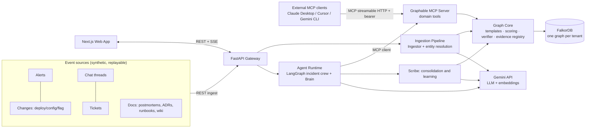
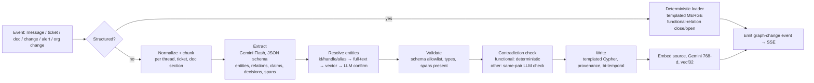
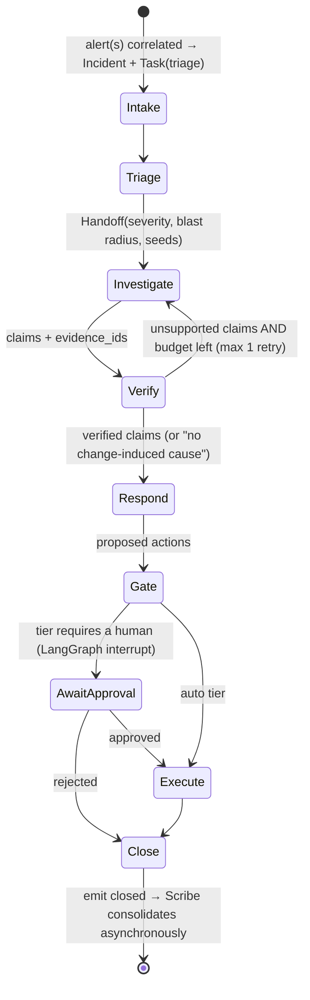
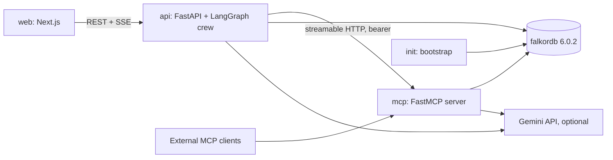

# Graphable: System Architecture

> Design document. Where it differs from the code, README.md and the code are authoritative.

**What it is:** a graph-native, multi-agent incident response system with a company brain. **FalkorDB is the system of record** for the company's knowledge, the agents' memory and the agents' coordination.
**Grounding:** every major decision cites RESEARCH.md (`R§n` = RESEARCH.md section n).

---

## 1. Engineering principles

| # | Principle | What it means in practice |
|---|---|---|
| P1 | **The graph is the source of truth** | Topology, knowledge, memory, coordination, evidence and audit all live in FalkorDB. Agent runtime state passes phase results within a run; everything that must survive or be shared is in the graph. Remove FalkorDB and nothing works (rule 3). |
| P2 | **Deterministic core, probabilistic edge** | Code does traversal, scoring, verification, gating and writes. The LLM selects, interprets, explains and drafts (R§0 decisions 1, 3, 11). |
| P3 | **Provable by construction** | Every claim carries `evidence_id`s from executed tool calls, and a code verifier rejects anything else (R§2.4). |
| P4 | **Never delete; invalidate** | Mutable facts are bi-temporal and episodic memory is append-only, so history is always queryable (R§3.4). |
| P5 | **Templated writes only** | The LLM emits typed JSON (Pydantic); only reviewed Cypher templates touch the graph (Zep pattern). |
| P6 | **One atomic statement per logical write** | FalkorDB has one writer per graph and no multi-statement transactions, so writes are idempotent `MERGE`/CAS statements (R§1.2). |
| P7 | **Tenant scope comes from authentication, never from the LLM** | The graph is chosen per tenant at the connection layer. Every template is scoped, including get-by-id (R§3.6). |
| P8 | **Bounded everything** | Hop caps ≤ 4–5, allowlisted relationship types, row limits, query timeouts, tool-call budgets per agent, LLM retries with backoff. |
| P9 | **Observable by design** | Every agent step, tool call, evidence item and action is a graph node, so the audit trail *is* the data model. |
| P10 | **Measured, not claimed** | An eval harness with ground truth and traps runs on every change to scoring (R§9). |

---

## 2. System context



---

## 3. Tech stack

| Layer | Choice | Why |
|---|---|---|
| Graph DB | **FalkorDB 6.0.2** in Docker (pinned tag) | Required; per-tenant graphs; vector and full-text indexes; algorithms (R§1) |
| Language | **Python 3.12**, `uv` for environments and locking | `falkordb` client 1.7.x needs ≥ 3.10 |
| Graph client | `falkordb` Python client (synchronous), one cached client per process | Shared by the API, the MCP server and the workers |
| Contracts | Typed Python tool signatures (FastMCP derives the MCP input schemas from them); **Pydantic v2** for API requests and the Gemini Investigator's structured output | Typed boundaries between LLM output and the graph |
| MCP server | Official `mcp` Python SDK (**FastMCP**), **streamable HTTP** transport, bearer auth | Real MCP that any MCP client can use (Track 1) |
| Agents | **LangGraph** (StateGraph, interrupts, checkpointer) + `langchain-google-genai` + `langchain-mcp-adapters` | Explicit state machine, human-approval gate, MCP tool loading (R§3.5) |
| LLM | **Gemini** (optional): Pro for the Investigator's review of the ranking; Flash for knowledge extraction and grounded Brain answers. Triage, Responder and Scribe are deterministic code | Reasoning where it matters, speed and cost everywhere else |
| Embeddings | Gemini embeddings, **768-dim** (output dimensionality reduced) | Keeps vector memory small |
| Analytics | FalkorDB `algo.pageRank` and `algo.betweenness` (importance, never cause); root-cause scoring in plain Python | Built-in algorithms run where the data is |
| API | **FastAPI** + Uvicorn, **SSE** for live agent events | Simple streaming |
| Web | **Next.js (App Router) + TypeScript + Tailwind**, Recharts for charts, a custom SVG graph view (`apps/web/components/NetGraph.tsx`) | Deterministic layouts: the same data always draws the same picture |
| Deploy | **Docker Compose** locally: FalkorDB, bootstrap, MCP server, API, web (one backend image) | The full local setup. The hosted demo (`render.yaml`: one backend service with MCP mounted at `/mcp`, FalkorDB Cloud free tier, web app on Vercel) is described in §13 |
| Secrets | `.env` (git-ignored; template in `.env.example`) | No keys in the repo |
| Quality | `pytest` integration tests against a bootstrapped FalkorDB (`tests/test_system.py`); eval harness (§14) | — |

---

## 4. Logical architecture: components

### 4.1 Graph Core (`graphable.core`), the heart of the system
- **Connection and tenancy:** `TenantGraph(tenant_id)` maps to graph `t_<tenant>`. Every query goes through it. The read path uses `ro_query` with timeouts.
- **Query templates:** parameterized Cypher inside the tool functions in `graphable/core/tools.py` (all listed in `docs/QUERIES.md`). Hop bounds and relationship types come from allowlists and are inlined after validation (FalkorDB can't parameterize them). Nullable grouping keys are `coalesce()`d (FalkorDB issue #3150).
- **Evidence registry:** every read tool registers what it returned as an `Evidence` node:
  - `{id, tool, params, node_ids, edge_keys, summary, ts, incident_id, agent, run_id}`, linked to its `Incident` and to the `AgentStep` that made the call.
  - Edges are identified by a stable key `src_id|TYPE|dst_id`, never by internal IDs.
- **Scoring:** root cause (§9.1), similarity (§9.2), expertise (§9.3), action-gate score (§9.4). These are pure functions over tool results, so they can be unit-tested.
- **Verifier:** checks claims against the evidence registry (§8.4).
- **Analytics:** PageRank and seeded betweenness are computed on demand by `graph_hubs` (FalkorDB `algo.*`). Change-risk priors are computed at query time inside the root-cause ranker.

### 4.2 Graphable MCP Server (`graphable.mcpserver`)
- FastMCP over streamable HTTP. One bearer token per tenant **resolves the tenant**; the LLM never passes it.
- Tools are thin wrappers over Graph Core (`graphable/core/tools.py`) and return JSON. Exceptions come back as MCP errors (`isError`); rejected inputs come back as an `error` field with an actionable message.
- Annotations: `readOnlyHint` on reads; `destructiveHint=false` on memory writes; actions marked `destructiveHint=true`.
- DNS-rebinding protection is on; allowed Host headers come from `MCP_ALLOWED_HOSTS`.
- Tool catalogue: §7.

### 4.3 Agent Runtime (`graphable.agents`)
- **Incident Crew** (a LangGraph StateGraph): Triage → Investigator → Verifier → Responder → Action Gate → Close (§8).
- **Brain:** company-brain Q&A with citations (Track 3): an intent router over MCP tools; free-form questions use hybrid search and, with a Gemini key, an answer written only from the retrieved sources. Conversations are stored as `Session` → `Turn` → `Answer`.
- **Scribe:** consolidation and learning when an incident closes (Track 2).
- Agents load MCP tools through `MultiServerMCPClient` and are **filtered to role-specific subsets** (`ROLE_TOOLS` in `graphable/core/tools.py`).
- Agents call tools through the MCP server (`McpBus`) or, as a fallback and for fast evals, in-process (`DirectBus`). Both log every call as an `AgentStep`.

### 4.4 Ingestion Pipeline (`graphable.ingest`)
- **Structured records** (changes, alerts, on-call, org changes, ticket metadata) go to deterministic loaders with templated `MERGE`.
- **Prose** (threads, tickets, docs) goes to the **Ingestor**: a rules extractor (always) plus Gemini extraction (when a key is set) → resolve → validate against the schema allowlist → templated write with provenance (§6). Embeddings are a separate bootstrap step.

### 4.5 API Gateway (`graphable.api`)
REST endpoints for ingestion, incidents, approvals, Brain Q&A, entity pages and eval results, plus SSE streams of agent events (§11).

### 4.6 Web App (`apps/web`)
Six screens (§12).

### 4.7 Scenario Player and Eval Harness (`graphable.sim`, `graphable.evals`)
- Writes a scenario's events (changes, alerts, messages) into a tenant graph, then runs graph-based intake; this drives the live demo.
- Runs test scenarios headless and computes the scoreboard (§14).

---

## 5. Data model (FalkorDB)

Full field lists for the generator are in DATA_SPEC.md. This section is the architectural contract.

### 5.1 Conventions
- **IDs:** string, with a type prefix: `svc_checkout`, `per_0042`, `team_payments`, `chg_008812`, `inc_0311`, `msg_…`, `doc_…`, `tkt_…`, `ev_…`, `step_…`.
- **Time:** epoch-ms integers (`*_at`, `ts`). FalkorDB has no timezone types (R§1.2).
- **Bi-temporal properties on mutable edges** (†): `valid_from`, `valid_to` (null means current), `recorded_at`, `expired_at` (null means current belief), `source_id`, `confidence`.
- **Provenance on extracted facts:** `source_id`, `span` (a quoted excerpt), `extracted_by` (ExtractionRun id), `confidence`.
- **Memory-type tag** on nodes where useful: `mem: 'semantic'|'episodic'|'procedural'|'working'` (CoALA, R§3.1). This makes the memory layers visible in the browser.

### 5.2 Node labels

| Group | Labels |
|---|---|
| Org (semantic) | `Person`, `Team`, `OnCallShift` |
| Systems (semantic) | `Service`, `Endpoint`, `Datastore`, `FeatureFlag`, `Region` (`Service` and `Datastore` also carry the shared label `Component`) |
| Change and ops (episodic sources) | `Change`, `Alert` |
| Knowledge sources (PROV Entities) | `Thread`, `Message`, `Ticket`, `Doc` (kind: postmortem, design, wiki), `Runbook`, `Step` |
| Knowledge (semantic) | `Decision`, `Claim`, `Topic` (optional) |
| Incident memory (episodic) | `Incident`, `Hypothesis`, `Action` |
| Agent memory and coordination | `Agent`, `AgentRun`, `AgentStep`, `Task`, `Handoff`, `IncidentBrief`, `Evidence`, `Answer`, `Session`, `Turn` |
| Procedural learning | `Lesson`, `Reflection` (Runbook and Step are shared with knowledge) |
| Pipeline | `ExtractionRun`, `Unresolved` |

### 5.3 Relationship types (direction is semantic)

> Design schema. Not created by the current code: `ASSERTED_BY`, `IMPLEMENTS`, `APPROVED_BY`, `DEPLOYED_IN`, `REFUTED_BY`, and the `Topic` and `Claim` labels (`Claim` only has an index). The implemented model is `graphable/core/schema.py` and the README's graph data model.

| Domain | Relationships |
|---|---|
| Org | `(Person)-[:MEMBER_OF†]->(Team)`, `(Team)-[:OWNS†]->(Service)` (exactly one active), `(Person)-[:HAS_SHIFT]->(OnCallShift)-[:COVERS]->(Team)`, `(Person)-[:REPORTS_TO†]->(Person)` |
| Topology | `(Service)-[:DEPENDS_ON† {kind: sync\|async\|db\|cache\|queue, critical}]->(Service\|Datastore)`, `(Service)-[:EXPOSES]->(Endpoint)`, `(Service)-[:DEPLOYED_IN]->(Region)`, `(FeatureFlag)-[:GATES]->(Service)` |
| Change | `(Change)-[:CHANGED]->(Service\|Datastore\|FeatureFlag)`, `(Person)-[:AUTHORED]->(Change)`, `(Person)-[:REVIEWED]->(Change)`, `(Change)-[:IMPLEMENTS]->(Decision)` |
| Signals | `(Alert)-[:FIRED_ON]->(Service)`, `(Alert)-[:PART_OF]->(Incident)` |
| Incident memory | `(Incident)-[:AFFECTED]->(Service)`, `(Incident)-[:CAUSED_BY {source_id,confidence}]->(Change\|Service)`, `(Incident)-[:SIMILAR_TO {score, basis, computed_at}]->(Incident)`, `(Person)-[:RESPONDED {role: commander\|fixer\|helper}]->(Incident)`, `(Incident)-[:RESOLVED_BY]->(Person)`, `(Incident)-[:MITIGATED_WITH {outcome, verified}]->(Runbook)`, `(Incident)-[:HAS_HYPOTHESIS]->(Hypothesis)-[:SUPPORTED_BY\|REFUTED_BY]->(Evidence)` |
| Knowledge and provenance | `(Message)-[:IN]->(Thread)`, `(Message)-[:REPLY_TO]->(Message)`, `(Person)-[:SENT]->(Message)`, `(Person)-[:WROTE]->(Doc\|Runbook)`, `(Thread\|Ticket\|Doc)-[:MENTIONS]->(*)`, `(Decision)-[:DOCUMENTED_IN]->(Doc)`, `(Decision)-[:DISCUSSED_IN]->(Thread\|Ticket)`, `(Decision)-[:DECIDED_BY]->(Person)`, `(Decision)-[:AFFECTS]->(Service)`, `(Decision)-[:SUPERSEDES]->(Decision)`, `(Ticket)-[:ASSIGNED_TO]->(Person)`, `(Ticket)-[:RESOLVED_BY]->(Person)`, `(Ticket)-[:FOLLOW_UP_OF]->(Incident)`, `(Claim)-[:SUPPORTED_BY {span}]->(Message\|Doc\|Ticket)`, `(*)-[:ASSERTED_BY]->(ExtractionRun)` (AriGraph/PROV) |
| Procedural | `(Runbook)-[:HAS_STEP]->(Step)-[:NEXT]->(Step)`, `(Runbook)-[:MITIGATES]->(Service)`, `(Runbook)-[:SUPERSEDES]->(Runbook)`, `(Lesson)-[:DERIVED_FROM]->(Incident)`, `(Lesson)-[:ABOUT]->(Service\|Runbook)` |
| Agent coordination | `(Task)-[:FOR]->(Incident)`, `(Handoff)-[:FOR]->(Incident)`, `(Handoff)-[:FROM]->(Agent)`, `(Handoff)-[:TO]->(Agent)`, `(Handoff)-[:CARRIES]->(Hypothesis\|Evidence)`, `(AgentRun)-[:OF]->(Agent)`, `(AgentRun)-[:WORKED_ON]->(Incident)`, `(AgentRun)-[:INFORMED_BY]->(AgentRun)` (PROV wasInformedBy), `(AgentStep)-[:IN_RUN]->(AgentRun)`, `(AgentStep)-[:NEXT]->(AgentStep)`, `(AgentStep)-[:PRODUCED]->(Evidence)`, `(Action)-[:FOR]->(Incident)`, `(Action)-[:JUSTIFIED_BY]->(Evidence)`, `(Action)-[:APPROVED_BY]->(Person)` |
| Q&A memory | `(Session)-[:HAS_TURN]->(Turn {n, question, entity_id})-[:ANSWERED_BY]->(Answer)`, `(Answer)-[:CITES {verdict}]->(Evidence)`, `(Answer)-[:GENERATED_BY]->(AgentRun)` |
| Derived (computed, never ground truth) | `(Person)-[:KNOWS {score, evidence_count, last_evidence_at, computed_at}]->(Service)` (design only: expertise is computed on demand by `org_experts` and not materialized) |

### 5.4 Indexes and constraints (created by the migration step)
- **Range indexes:** `id` on every label in `graphable/core/schema.py`; also `Component.name`, `Service.name`, `Datastore.name`, `Change.ts`, `Alert.ts`, `Incident.started_at`, `Incident.key`, `Message.ts`, `Person.handle`, `Task.status`, `Runbook.key`, `Decision.key`, `Ticket.key`, `Action.idem_key`, and `valid_to` on `DEPENDS_ON` and `OWNS`.
- **Unique constraints** (`GRAPH.CONSTRAINT`, after the range index): `id` on Component, Person, Team, Change, Incident, Message, Thread, Ticket, Doc, Runbook, Decision, Evidence and Action.
- **Full-text indexes** (DDL form only; the procedure form is broken on 6.x): `Runbook(title, text)`, `Doc(title, text)`, `Ticket(title, text)`, `Message(text)`, `Component(name, aliases_text)`, `Person(name, handle)`, `Incident(title)`.
- **Vector indexes** (768-dim, cosine; always write with `vecf32()`; created only when Gemini embeddings are enabled): `Incident.embedding`, `Thread.embedding`, `Doc.embedding`, `Ticket.embedding`, `Runbook.embedding`. Messages are **not** embedded individually, to save memory.

### 5.5 Tenancy
- **One graph per tenant:** `t_acme` (main company) and `t_globex` (a small second company with **identical service names**, for the isolation tests).
- **Golden snapshots:** bootstrap saves `golden_acme` and `golden_globex`. The web app's demo tenant `t_demo_main` is a `GRAPH.COPY` of `golden_acme`, and `POST /v1/admin/reset` restores it. Every eval scenario also runs on a fresh copy.
- **Shared nothing:** no cross-graph queries, so tenant isolation is structural.

---

## 6. Ingestion pipeline: how the company brain stays current (Track 3)

> Implemented: deterministic loaders, Gemini or rules extraction, resolution by id/handle/alias, full-text and vector search, validation, and the functional-relation check that closes the old `OWNS` edge and opens the new one. Design only: the LLM confirm step in resolution, an LLM contradiction check, the `RELATED_TO` escape hatch and graph-change events over SSE.



**Rules:**
- Extract **one thread, ticket or doc section per call** (small chunks, R§4.4).
- The extraction schema enumerates the allowed labels and relationship types, with a `RELATED_TO {label}` escape hatch that is canonicalized later or dropped (EDC).
- **Never create a Service or Person from prose.** Unknown mentions become `Unresolved` nodes for review (no over-merging, R§4.4).
- **Functional relations** (`OWNS`, `MEMBER_OF`, active on-call) are closed and opened in one statement. Example: "checkout moved to Team Orbit" sets `valid_to` on the old `OWNS` and creates the new one with `source_id = msg_…`.
- **Contradiction check before deduplication** (MemClaw ordering, R§3.4).
- **Idempotency key** = `source_id + extractor_version`, so re-ingesting is a no-op.
- Each run creates an `ExtractionRun{model, prompt_version, at}` node, and every extracted edge points to it.
- **Prompt-injection hygiene:** source text goes inside a delimited "DATA" block, the model is told to treat it as data, and extraction output has no tool-calling ability.

**Staleness** (DOCER rules, R§4.6) is computed when `knowledge_for_entity` reads a runbook. A `Runbook` is flagged when
- it mentions a dependency that has been removed,
- it is active and its `last_verified_at` is more than 90 days before the latest `Change` to its service, or
- its author has `left_at` set.

Docs are returned with an `author_left` flag.

---

## 7. MCP tool catalogue (Graphable MCP Server)

Names are namespaced with underscores. Most reads register what they returned as `Evidence` and return its `evidence_id`, with a compact, ranked payload (most important first). Signatures below match `graphable/mcpserver/server.py`; many tools also accept an optional `incident_id` that ties their evidence to an incident.

| # | Tool | Purpose | Notes |
|---|---|---|---|
| 1 | `graph_resolve(text, kinds?, k=5)` | Entity linking | exact id/key/name/alias → full-text → fuzzy full-text |
| 2 | `graph_schema()` | Labels and relationships, **with direction in English** | "A DEPENDS_ON B: A calls B; if B fails, A is impacted" |
| 3 | `graph_neighbors(node_id, rel_types?, direction="both", limit=25)` | Local exploration | **Hub rule:** degree > 40 with no filter → counts by relationship type only |
| 4 | `incident_blast_radius(entity_id, max_hops=3)` | Upstream impact (`max_hops` 1–4) | hops, entry points, owners, tiers |
| 5 | `incident_rank_root_causes(incident_id, window_min=120, max_hops=5, top_k=5)` | Root-cause candidates with a **score breakdown** | §9.1 |
| 6 | `graph_explain_connection(from_id, to_id, max_len=4, k=3, rel_types?)` | Paths between two entities (`max_len` 1–5) | `allShortestPaths` |
| 7 | `incident_similar(incident_id, phase="triage"\|"post", k=5, root_entity_id?, root_kind?)` | Structural + vector similarity | fixer, runbook |
| 8 | `org_ownership(entity_id, at?)` | Owner team, on-call, escalation, **as of a time** | bi-temporal |
| 9 | `org_experts(entity_id, k=5)` | Expertise ranking, top-3 evidence each, **bus factor** | §9.3 |
| 10 | `knowledge_for_entity(node_id, kinds?, k=3)` | Runbooks (with staleness reasons), docs, decisions, lessons | "graph to find, text to explain" |
| 11 | `knowledge_search(query, kinds?, k=8)` | Full-text search, plus vector search when a Gemini key is set, fused by reciprocal rank | Brain |
| 12 | `decision_trace(decision)` | ADR key, id or text → docs, discussions, decider, supersedes chain, affected components | Track 3 |
| 13 | `graph_hubs(metric="pagerank"\|"betweenness", k=10, of?)` | FalkorDB PageRank / betweenness (fixed seed), computed on demand; `of` returns the rank of given components | importance, **not** cause |
| 14 | `graph_cypher_readonly(cypher, purpose, params?)` | Guarded escape hatch | write clauses rejected, bounded `*` (≤ 5), only full-text, vector and `algo` procedures, EXPLAIN pre-check, ≤ 50 rows |
| 15 | `memory_note(incident_id, kind: hypothesis\|finding\|ruled_out, claim, evidence_ids, confidence, about_id?)` | Write to the blackboard | rejects unknown or foreign evidence |
| 16 | `memory_handoff(incident_id, to_role, summary, open_questions, evidence_ids)` | Structured handoff | MAST fields |
| 17 | `memory_recall(entity_id, k=5)` | Lessons (votes > 0) and reflections about a component | procedural memory |
| 18 | `action_create_ticket(incident_id, team_id, title, body, evidence_ids)` | Gated T1 | idempotency key |
| 19 | `action_page_oncall(incident_id, person_id, reason, evidence_ids)` | Gated T2 | idempotency key |
| 20 | `action_propose_remediation(incident_id, kind, target_id, rationale, evidence_ids)` | T3, always a proposal | idempotency key |
| 21 | `memory_inbox(incident_id, role?)` | Read the latest handoff addressed to this agent and mark it accepted | coordination through the graph |

**Role subsets** (`ROLE_TOOLS`):

| Agent | Tools |
|---|---|
| Triage | 1, 4, 7, 8, 13, 15, 16 |
| Investigator | 21, 1, 3, 5, 6, 7, 10, 14, 15, 16 |
| Responder | 21, 8, 9, 10, 17, 15, 18, 19, 20 |
| Brain | 1, 3, 4, 8, 9, 10, 11, 12, 14 |

Scribe and Ingestor call Graph Core directly; they are workers, not tool-selecting agents.

---

## 8. Agent architecture (LangGraph)

### 8.1 Agent roster

| Agent | Type | Model | Memory it reads | Memory it writes |
|---|---|---|---|---|
| **Triage** | Fixed procedure (code) | none | semantic (topology, ownership, PageRank rank of the alerting components), episodic (similar incidents) | finding note, severity, Handoff |
| **Investigator** | Fixed procedure; with a Gemini key, a bounded ReAct review (tool budget enforced in code) | Pro (review only) | all three | Hypotheses (proposed/ruled_out), notes, Handoff |
| **Responder** | Fixed procedure (code) | none | procedural (runbooks, lessons), org | Actions (gated), status update |
| **Brain** | Intent router + hybrid search, with citations | Flash (grounded answers, optional) | everything, read-only | Session, Turn, Answer + CITES |
| **Scribe** | Runs when an incident closes (code) | none | the closed incident's investigation | SUSPECTED_CAUSE, SIMILAR_TO, Lesson, proposed Runbook; on feedback: CAUSED_BY, lesson votes, Reflection |
| **Ingestor** | Pipeline worker | Flash (optional; rules otherwise) | resolution indexes | Knowledge facts with provenance |

### 8.2 Incident Crew state machine



**LangGraph state:** the crew's state carries each phase's result (triage, investigation, verification, response) between nodes inside one run. The coordination record is the graph: each phase claims its `Task` with a compare-and-set, the Investigator and Responder read the `Handoff` addressed to them (the Responder takes the root cause from it), hypotheses, evidence, actions and lessons are graph nodes, and a crash leaves a complete audit trail in FalkorDB.

**Checkpointer:** LangGraph's in-memory checkpointer (`InMemorySaver`) is used only to **resume runs and interrupts** inside the API process. Durable memory is our graph.

### 8.3 Intake: graph-based alert correlation
Alerts within 5 minutes of each other whose services are connected within 2 `DEPENDS_ON` hops (in either direction) are grouped into one `Incident`. This is a small graph query and avoids opening one incident per alert. Each crew phase then claims its Task with a single-statement compare-and-set (R§3.6), so a second crew on the same incident stops instead of duplicating work. Intake itself reads unassigned alerts and then creates the incident in a separate statement, so two intakes racing on the same alerts could both open an incident; the demo runs one intake at a time.

### 8.4 Verifier (pure code)
For each claim:
1. Every `evidence_id` exists **and** belongs to this incident.
2. Every edge key in that evidence exists in the graph (re-matched by `src|TYPE|dst`) and was valid at incident time.
3. Every entity the claim names (resolved IDs) appears in the cited evidence's node set.

Failing claims are marked unverified with their reasons and shown as rejected, not as fact. The output records `path_validity` for the scoreboard.

### 8.5 Prompts and contracts
- The Gemini Investigator gets a system prompt plus a JSON brief: Triage's handoff (read from the graph), the ranked change and non-change candidates, the deterministic choice, the evidence behind each claim and similar past incidents.
- Its output is a Pydantic model (Gemini structured output). Its tool budget is enforced in code, and any LLM failure or timeout leaves the deterministic conclusion in place.

### 8.6 Concurrency
- Several incidents can run at once; each crew is its own LangGraph thread.
- Graph writes are single-statement and idempotent, and task claims use CAS with leases.
- `Action.idem_key` is unique, so the same page is never sent twice.
- The tests and the system eval race many workers for one task and one page, and assert exactly one successful claim and one `Action`.

---

## 9. Algorithms (full rationale in R§7)

### 9.1 Root-cause ranking (`incident_rank_root_causes`)
1. **Candidates:** services `c` reachable along `DEPENDS_ON*0..5` from the alerting set A (as of the incident time). Changes `x` on `c` with `t0−2h ≤ ts ≤ t0+5min`.
2. **Score:** `S = 0.30·P + 0.25·R + 0.15·Cov + 0.15·F + 0.10·K + 0.05·H`

   | Term | Meaning |
   |---|---|
   | P | Proximity, `2/(2+h)` |
   | R | Recency decay |
   | Cov | Ochiai coverage across symptom chains |
   | F | Frontier: alerting with healthy dependencies, or a silent convergence point |
   | K | Smoothed change-failure prior for (kind, service), plus a canary bonus |
   | H | Similarity to past incidents with the same (service, kind) |

3. **Ties:** no separate tie-break step. Candidates are sorted by score with Python's stable sort, so equal scores keep the order the changes query returned.
4. **Abstain:** if `max S < θ`, return non-change hypotheses (frontier or coverage service with a fault-type guess).
5. **Output:** ranked candidates with a per-term breakdown and evidence IDs. The UI shows the breakdown as a bar.

Weights and θ are tuned on training seeds only and frozen before the test run. The formula above is the original design; the code keeps research-prior weights (`W_PRIOR`) and the tuned weights it uses (`W`, `ABSTAIN_THETA`) in `graphable/core/tools.py`. The term definitions in code are in `docs/QUERIES.md` §2.

### 9.2 Similarity (`incident_similar`)
`sim = 0.35·s_root + 0.20·s_kind + 0.15·J(symptoms) + 0.15·J(blast) + 0.15·cos(text)`
- **Triage phase:** no root yet, so only the J, J and cos terms, renormalized.
- **Post-investigation:** uses the top root candidate (`root_entity_id`, `root_kind`).
- **Retrieval:** incidents that share affected components, plus HNSW vector neighbours (top 40) when the incident is embedded. Final score `0.9·sim + 0.05·0.99^days`, plus 0.05 when the past incident has a runbook.
- The query incident and anything after `t0` are excluded (no leakage).

### 9.3 Expertise (`org_experts`)
`score(p,s) = Σ w(type)·2^(−Δt/H)`, computed on demand by `org_experts` (no materialized `KNOWS` edge); departed people are listed separately.
- **Weights:** fixer 5, postmortem/design author 4, runbook author 3, ticket resolver 3, change author 2, wiki author 2, reviewer 1.5, commander 1.5, helper 1.5, help-thread answer 1 (max 1 per thread).
- **Half-life H:** 180 days, or 365 for designs.
- **Bus factor:** the number of active people with normalized score ≥ 0.75. Departed experts are listed with ranked successors.

### 9.4 Action gate score
`G = confidence × verified_path(0/1)`, where confidence is the top candidate's score, halved when the Gemini review disagrees (the incident is then marked contested). Tiers: T0 automatic; T1 automatic if `G ≥ 0.6` and the path is verified; T2 needs approval unless SEV-1 and `G ≥ 0.8` with a verified path; T3 always proposal only. The gate is enforced server-side in the action tools.

### 9.5 Memory retrieval (`memory_recall`)
`memory_recall(entity_id)` returns the component's lessons with votes > 0 (highest votes first) and its reflections (newest first). Among the agents, only the Responder uses it. Nothing is deleted; retired lessons stay in the graph.

---

## 10. Memory lifecycle (Track 2 at a glance)

| CoALA memory | Where | Written by | Updated how | Read by |
|---|---|---|---|---|
| Working | LangGraph crew state and the latest `Handoff` | Orchestrator, agents | Per phase | The next agent (`memory_inbox`) |
| Episodic | Incident, Alert, AgentRun/Step, Hypothesis, Evidence, Action, Session/Turn | Agents (append-only) | Never mutated; status on Hypothesis/Task only | Triage, Investigator (similar incidents), Brain |
| Semantic | Org, topology, decisions, knowledge facts | Loaders, Ingestor | Bi-temporal invalidate-and-open | All |
| Procedural | Runbook/Step, Lesson (votes), Reflection | Scribe (proposals), humans (feedback) | Lessons: `proposed → active` on confirmed feedback, votes ±1 per outcome, retired at 0 (ExpeL). Induced runbooks stay `proposed` (Voyager gate) | Responder |
| Coordination | Task (A2A states), Handoff, Agent, AgentRun `INFORMED_BY` | Agents | CAS claims with leases | Orchestrator, agents |

**Scribe consolidation on close:**
1. The agents' conclusion as `SUSPECTED_CAUSE` (never as fact).
2. `SIMILAR_TO` edges (top 3).
3. A `proposed` Lesson about the root component.
4. A *proposed* runbook when the component has no active runbook.

The suspected cause, `SIMILAR_TO` links and Lesson use `MERGE`. Human feedback (`POST /v1/incidents/{id}/feedback`) then promotes the suspicion to `CAUSED_BY` and upvotes the lesson, or downvotes it and records the real cause plus a `Reflection`. Incident embeddings are written at intake, not by the Scribe.

---

## 11. API design (FastAPI)

| Method | Path | Purpose |
|---|---|---|
| GET | `/v1/health` | Liveness, LLM on/off, demo tenant |
| GET | `/v1/overview` | Graph counts, recent incidents, teams |
| GET | `/v1/scenarios` | Playable scenarios |
| POST | `/v1/sim/play` | Play a scenario into the tenant graph, run intake, start the crew |
| GET | `/v1/incidents/{id}/stream` | **SSE**: live agent events for a run |
| GET | `/v1/incidents/{id}` | Incident with alerts, hypotheses, actions, handoffs, suspected and confirmed causes, similar incidents |
| POST | `/v1/actions/{id}/approve` · `/reject` | Resume the LangGraph interrupt |
| POST | `/v1/incidents/{id}/feedback` | Human feedback on the diagnosis (Scribe learning) |
| POST | `/v1/brain/ask` | Company-brain Q&A with citations and paths |
| GET | `/v1/entities` · `/v1/entities/{id}` | Component list; component page data (ownership and history, experts, bus factor, knowledge, dependencies, recent changes, incidents) |
| GET | `/v1/graph/topology` · `/v1/graph/incident/{id}` | Graph data for the web app's graph views |
| POST | `/v1/ingest/message` | Live ingest of a chat message (extraction with provenance) |
| GET | `/v1/memory` · `/v1/people` | Agent memory overview; people list |
| POST | `/v1/admin/reset` | `GRAPH.COPY` `golden_acme` → demo tenant |
| GET | `/v1/eval` | Evaluation results from `evals_out/` |

Auth: the `X-API-Key` header maps to a tenant through `TENANT_KEYS` (P7); a request without the header uses the demo tenant (`DEMO_TENANT`). CORS origins come from `CORS_ORIGINS` (default `*`). `graphable/api/app.py` is authoritative for the route list.

---

## 12. Web app screens

1. **Incident Command (hero screen)**
   - Live alert feed.
   - Three agent "lanes" (Triage, Investigator, Responder) streaming steps.
   - Graph canvas highlighting the blast radius (heat by hop) and the root-cause path (bold).
   - Hypothesis cards with **score-breakdown bars** and verified ✓ / ⚠ badges.
   - "Similar past incidents" with fixer and runbook.
   - Action panel with an **Approve / Reject** gate.
2. **Ask the Brain:** chat with numbered citations; clicking one opens the source and highlights the **graph path** that justified the answer. Includes as-of time travel ("who owned checkout on 2026-03-14?").
3. **Service and Person pages:** owner vs experts, bus factor warning, dependencies, recent changes, runbooks with staleness flags, decision history, ownership timeline.
4. **Memory and learning:** lessons with vote history, runbook versions (proposed/active/deprecated), the learning-curve chart, agent handoff timeline (the PROV chain).
5. **Live ingest:** paste a message or doc and watch the extracted facts appear with provenance, including invalidations ("OWNS checkout→Payments ended; OWNS checkout→Orbit started").
6. **Scoreboard:** eval metrics vs baselines (§14), including the headline chart AC@1 vs number of concurrent changes.

Graphs are drawn with a custom SVG component (`apps/web/components/NetGraph.tsx`). The web app uses the demo tenant; tenant isolation (acme ↔ globex) is checked by the tests and the system eval.

---

## 13. Deployment topology


- **Supported setup: local Docker Compose** (`docker compose up --build`): FalkorDB (pinned 6.0.2), a one-shot `init` bootstrap, the MCP server, the API and the web app. These are the full local setup instructions rule 10 requires.
- **One backend image, several entrypoints** (`init`, `mcp`, `api`); the web app has its own image.
- **Hosted demo (`render.yaml`):** the backend image as one web service (API with the MCP server mounted at `/mcp`, `SERVE_MCP=1`), FalkorDB Cloud's free tier (v4.22, 100 MB) holding one demo graph restored from `deploy/demo_snapshot.dump`, and the web app on Vercel. The snapshot drops run-time records and the Ticket/Thread embeddings to fit; reset and self-healing use `RESTORE`.

**Configuration (env):** see `.env.example`. Main variables: `GEMINI_API_KEY`, `GEMINI_MODEL_PRO`, `GEMINI_MODEL_FLASH`, `EMBED_MODEL`, `EMBED_DIM=768`, `FALKORDB_HOST`, `FALKORDB_PORT`, `FALKORDB_USERNAME`, `FALKORDB_PASSWORD`, `QUERY_TIMEOUT_MS`, `TENANT_KEYS`, `MCP_URL`, `MCP_ALLOWED_HOSTS`, `DATA_DIR`. On the FalkorDB server (`FALKORDB_ARGS` in docker-compose.yml): `TIMEOUT_DEFAULT 10000 TIMEOUT_MAX 120000`.

---

## 14. Evaluation harness (from R§9)
- **Input:** ~40 held-out test scenarios with ground truth (DATA_SPEC §8), never loaded as history.
- **Runner:** plays each scenario into a fresh `GRAPH.COPY` of the golden tenant, runs the crew headless, and records outputs.
- **Metrics:**
  - AC@1/3, MRR, abstention and non-change origin accuracy (`graphable/evals/rca.py`)
  - path validity and claims verified, routing to the correct team, auto-ticket precision, tool calls and latency (`graphable/evals/system.py`)
  - duplicate claims and pages under concurrency
  - tenant leakage
  - stale answers after ownership changes (knowledge-update probes)
  - Brain Q&A accuracy and citation rate
  - learning curve
  - extraction precision/recall (`graphable/evals/extraction.py`)
- **Baselines:** random change in the window, most-recent change, toy (hops → recency), research-prior weights; with a Gemini key, the crew with the Gemini review.
- **Output:** `evals_out/*.json`, shown on the Scoreboard (`GET /v1/eval`).

---

## 15. Repository layout
```
graphable/                   (repo root)
  graphable/
    core/                    tenancy (db), schema, domain tools with their Cypher, evidence registry, verifier, embeddings
    mcpserver/               FastMCP server (tools → core)
    agents/                  LangGraph crew, policies (offline + Gemini), Brain, Scribe, tool buses (MCP / direct)
    ingest/                  loader (systems of record), extractors, pipeline (prose → facts with provenance)
    api/                     FastAPI routes, SSE
    sim/                     scenario player + graph-based intake
    evals/                   RCA, extraction and system evaluation
    bootstrap.py, settings.py
  apps/web/                  Next.js app
  datagen/                   synthetic world generator (DATA_SPEC); out/ holds the committed dataset
  docs/                      ARCHITECTURE.md, RESEARCH.md, DATA_SPEC.md, QUERIES.md
  tests/                     integration tests against a bootstrapped FalkorDB
  evals_out/                 evaluation results
  Dockerfile, docker-compose.yml, .env.example, README.md
```
The Cypher lives inline in the Python modules (mostly `graphable/core/tools.py`) and is listed in `docs/QUERIES.md`, which covers the "Cypher queries the product depends on" submission requirement.

---

## 16. Security and safety
- **Tenancy:** auth sets the graph; no tool accepts a tenant or user ID; get-by-id is scoped too.
- **Query safety:** reads use `ro_query`; relationship types, labels and hop bounds are allowlisted; the escape-hatch Cypher gets an EXPLAIN pre-check, bounded paths and row caps.
- **Prompt injection:** all artifact text is treated as data (delimited); actions come only from verified evidence; procedural memory is gated (AgentPoison/MINJA, R§3.3).
- **Actions:** tiered gate, idempotency keys, an approver recorded on each `Action`. No real pager or rollback integrations exist; actions are simulated and recorded.
- **Secrets:** `.env` (git-ignored); MCP bearer tokens and API keys per tenant (`TENANT_KEYS`).
- **Data:** 100% synthetic, fictional company and people (rule 6).

## 17. Performance budgets
| Operation | Target |
|---|---|
| Read tool | p95 < 200 ms |
| Blast radius / root-cause ranking at ~40k nodes | < 300 ms |
| Triage | < 15 s |
| Full crew run | < 60 s |
| Brain answer | < 20 s |
| Ingesting one thread | < 5 s |
| Full data load | < 10 min |
| Full extraction | < 60 min with concurrency |

## 18. Risk register
| Risk | Impact | Mitigation |
|---|---|---|
| FalkorDB 6.x crash (#3150) | Demo down | `coalesce()` rule, template tests, pinned tag, golden reset |
| Cloud free tier size or deletion | Live deploy fails | Measure size; reseed from the committed data; local Docker Compose is the supported setup |
| Gemini rate limits | Slow generation or extraction | Paid key, concurrency limits, retries, cache extraction results by idempotency key |
| LangGraph + MCP adapter friction | Agents can't load tools | 1-hour spike first; fallback: direct core calls behind the same Pydantic contracts |
| FalkorDB LangGraph checkpointer immature | Resume breaks | Fall back to Redis/SQLite checkpointer (durable memory is ours anyway) |
| Scope | Unfinished | Strict build order (§19); "Could" items cut first |
| LLM nondeterminism in the demo | Inconsistent run | Fixed seeds/temperature 0, recorded demo run as backup, deterministic scoring core |

## 19. Build order
1. **Spike (1h):** FalkorDB connection; FastMCP + LangGraph + Gemini tool call end-to-end.
2. **Data:** datagen world + timeline + prose (§DATA_SPEC), then load. Run in the background while building the next steps.
3. **Core:** schema migration, templates, evidence registry, scoring, verifier, plus tests.
4. **MCP server:** tools 1–10, 15–16, 18–19 first.
5. **Crew:** the LangGraph state machine end to end on one hero scenario.
6. **Ingestion:** extractor and resolver on prose; live-ingest endpoint.
7. **API + SSE, then web:** Incident Command first, then Brain, Service page, Live ingest.
8. **Scribe:** consolidation; learning-curve scenario.
9. **Eval harness and Scoreboard.**
10. **Deploy, README, docs/QUERIES.md, demo video, blog post.**

Must / Should / Could priorities follow R§10, with the scale and extraction scope upgraded per the locked decisions.

## 20. Demo script (3–4 min), with hero scenarios from DATA_SPEC §9
1. **"Repeat offender"** (Tracks 1+2): an alert storm. Triage blast radius → Investigator ranks a config change; memory surfaces the 4-month-old twin incident, its fixer and its runbook. Verified path shown → ticket auto-created; page awaits approval → approve.
2. **"Decoy deploy"** (Track 1): 9 concurrent changes, the newest one innocent. The score breakdown shows why the silent cache config wins. Compare with the "most recent change" baseline on the Scoreboard.
3. **"The org moved"** (Tracks 3+2): paste the chat message "checkout moves to Orbit" into Live ingest → the OWNS edge closes/opens with provenance → rerun: the page goes to Orbit. Brain: "who owned checkout during INC-0287?" → the old team, with citations.
4. **"Not a change"** (Tracks 1+3): a cert-expiry incident → the agent abstains from blaming deploys, finds the cert runbook, and flags **bus factor = 1** (the vault expert left) with ranked successors.
5. **Close:** the Scoreboard (AC@1 vs number of concurrent changes, 100% path validity, 0 duplicate pages, 0 tenant leaks), and Claude Desktop connected to our MCP server to show it works outside our UI.
